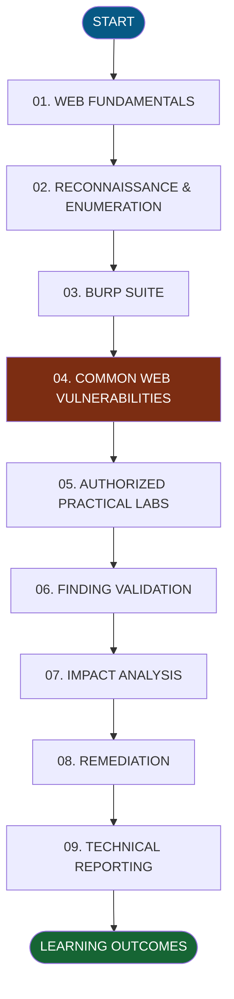
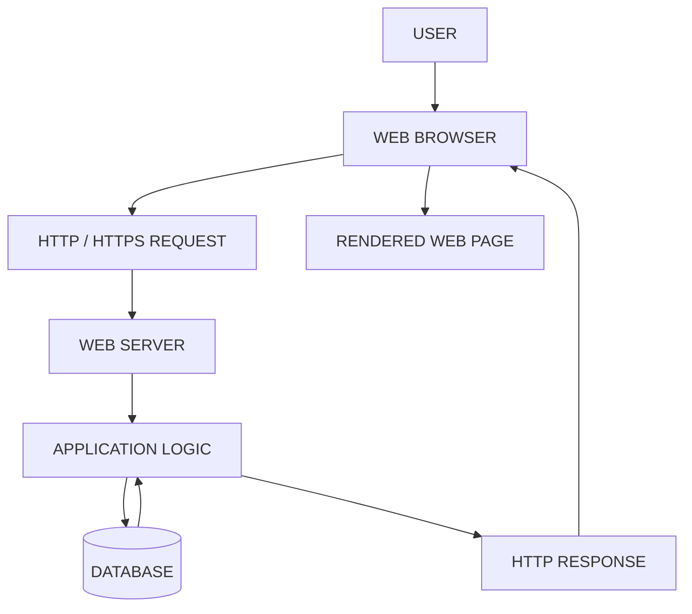
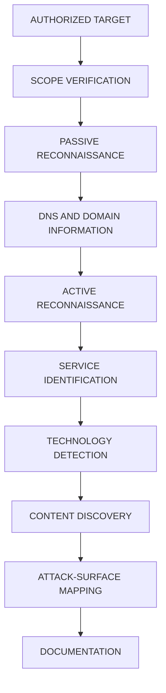
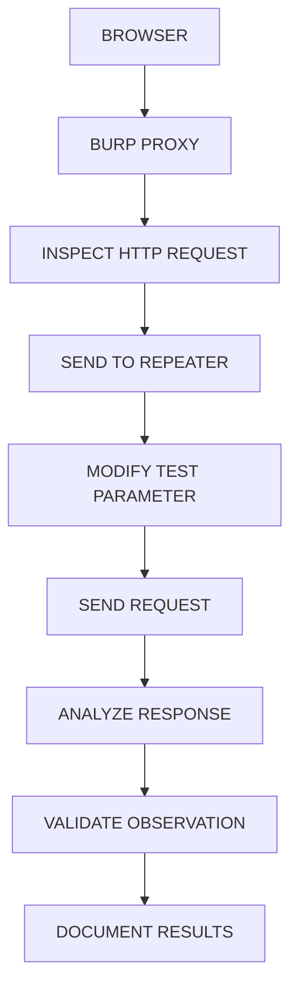
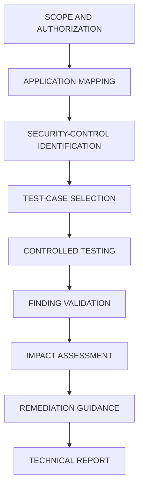

<div align="center">


# 🌐 WEB APPLICATION SECURITY

### Web Application Penetration Testing — Phase 1

**Learn • Understand • Analyze • Test • Secure**

Building a strong foundation in Web Application Security through structured learning, technical documentation, authorized practical labs, and vulnerability analysis.


</div>

---

# 📌 01. About the Project

Welcome to **Web Application Security — WAPT Phase 1**.

This repository documents my learning and practical work in Web Application Penetration Testing (WAPT) as part of my Web Application Penetration Testing internship at IqraSec Academy.

The primary objective is to understand how web applications operate, how browsers communicate with servers, how application components process user input, and how security professionals identify and validate common web application vulnerabilities.

Modern web applications consist of multiple interconnected components, including frontend interfaces, backend services, APIs, databases, authentication mechanisms, session-management systems, and access-control policies. Weaknesses in the design, implementation, or configuration of these components can introduce security risks.

Through this learning phase, I am developing a structured understanding of web technologies, reconnaissance, HTTP traffic analysis, vulnerability assessment, security remediation, and technical reporting.

This repository brings together learning documentation, PDF reports, lab references, tool usage, testing procedures, security concepts, and practical observations.

## What This Repository Contains

- Web application fundamentals and architecture.
- HTTP and HTTPS communication.
- Client-server request and response analysis.
- HTTP methods, status codes, headers, cookies, and sessions.
- DNS fundamentals and web technologies.
- Passive and active reconnaissance.
- DNS enumeration and subdomain discovery.
- Technology identification and content discovery.
- Attack-surface mapping.
- Burp Suite fundamentals and Repeater.
- Common web application vulnerabilities.
- Security-testing tools and command-line examples.
- Vulnerability validation and impact analysis.
- Security remediation and defensive practices.
- Technical documentation and reporting templates.
- References to established web security resources.

> **Project status:** This repository documents learning material and practical exercises. A topic appearing in the documentation does not automatically mean that every associated test has been performed or that a vulnerability has been confirmed.

**Designed for:** Cybersecurity students, beginners, and aspiring Web Application Penetration Testers.

---

# 🎯 02. Project Objectives

The primary goal of Phase 1 is to establish a practical foundation in web application security.

## Technical Objectives

1. Understand web application architecture and its major components.
2. Learn the differences between frontend and backend technologies.
3. Understand HTTP and HTTPS communication.
4. Analyze HTTP methods, status codes, headers, cookies, and sessions.
5. Understand DNS resolution and domain infrastructure.
6. Learn passive and active reconnaissance methodologies.
7. Identify technologies and services exposed by authorized targets.
8. Understand DNS enumeration and content discovery.
9. Learn to intercept and analyze HTTP traffic using Burp Suite.
10. Understand request modification and response analysis using Repeater.
11. Study common web application vulnerability classes.
12. Understand authentication and authorization controls.
13. Learn vulnerability validation in controlled environments.
14. Assess potential confidentiality, integrity, and availability impacts.
15. Understand vulnerability root causes and remediation.
16. Develop consistent technical documentation and reporting skills.

## Learning Outcomes

By working through this repository, I aim to improve my ability to:

- Explain web application technologies clearly.
- Interpret HTTP requests and responses.
- Understand application behavior and security controls.
- Follow a repeatable security-testing methodology.
- Distinguish potential vulnerabilities from validated findings.
- Record relevant evidence and reproduction steps.
- Explain technical impact without making unsupported claims.
- Recommend practical remediation measures.
- Maintain clear and organized technical documentation.

---

# 🗺️ 03. WAPT Learning Roadmap

The repository follows a structured learning path, progressing from web fundamentals to vulnerability analysis and technical reporting.



## Learning Stages

| Stage | Focus | Expected Outcome |
|---|---|---|
| Web Fundamentals | HTTP, HTTPS, architecture, DNS | Understand how web applications communicate. |
| Reconnaissance | Information gathering and enumeration | Identify the authorized application's attack surface. |
| Burp Suite | Proxy, Repeater, HTTP analysis | Inspect and compare application requests and responses. |
| Vulnerability Fundamentals | Common web security weaknesses | Understand vulnerability causes and behavior. |
| Practical Labs | Controlled security exercises | Apply concepts in intentionally vulnerable environments. |
| Finding Validation | Manual verification and evidence | Determine whether an observed weakness is reproducible. |
| Impact Analysis | Risk and business impact | Explain the realistic consequences of a finding. |
| Remediation | Defensive controls | Recommend fixes that address root causes. |
| Technical Reporting | Documentation and evidence | Communicate findings clearly and professionally. |

This roadmap describes the learning structure. Individual stages should be marked complete only when the associated exercises or learning objectives have been completed.

---

# 🌐 04. Web Fundamentals

**Objective:** Understand the structure, technologies, and communication mechanisms of modern web applications.

## 4.1 What Is a Web Application?

A web application is software accessed through a browser or another HTTP-capable client.

Examples include e-commerce platforms, online banking portals, dashboards, content-management systems, and cloud-based services.

A typical web application may contain the following components:

| Component | Function |
|---|---|
| Client | Initiates requests to the application. |
| Frontend | Presents the user interface and handles browser-side interactions. |
| Backend | Implements server-side application logic. |
| Web Server | Handles HTTP requests and serves or forwards responses. |
| Database | Stores and retrieves application data. |
| API | Defines interfaces through which application components communicate. |
| Authentication | Verifies the identity of a user or client. |
| Authorization | Determines which resources and operations a user may access. |
| Session Management | Maintains authenticated state across requests. |

Understanding these components helps identify where security controls should be implemented and how failures can affect the application.

## 4.2 Client-Server Architecture



In a typical architecture, the browser sends a request to the server, the application processes the request, and the server returns a response.

The backend may interact with a database, authentication provider, or other internal service before generating the response.

### Security Relevance

A security assessment may examine:

- Input validation.
- Authentication and authorization.
- Session handling.
- API security.
- Database query construction.
- Error handling.
- Sensitive data exposure.
- Server configuration.
- Access to restricted resources.

## 4.3 HTTP and HTTPS

HTTP is an application-layer protocol used for communication between clients and servers.

HTTPS is HTTP carried over TLS, providing transport encryption and helping authenticate the server.

HTTPS protects data in transit, but it does not automatically eliminate application-level vulnerabilities such as SQL Injection, XSS, or Broken Access Control.

### Common HTTP Methods

| Method | Purpose |
|---|---|
| GET | Retrieve a resource representation. |
| POST | Submit data or request an operation. |
| PUT | Create or replace a resource representation, depending on the API design. |
| PATCH | Apply a partial modification. |
| DELETE | Request resource deletion. |
| HEAD | Retrieve response headers without the response body. |
| OPTIONS | Discover communication options supported by a resource. |

### Common HTTP Status Codes

| Code | Meaning |
|---|---|
| 200 | Request succeeded. |
| 201 | Resource created successfully. |
| 301 | Permanent redirect. |
| 302 | Temporary redirect. |
| 400 | Bad request. |
| 401 | Authentication is required or has failed. |
| 403 | Requested operation is refused. |
| 404 | Resource not found or not disclosed. |
| 405 | HTTP method not supported for the resource. |
| 429 | Rate limit exceeded. |
| 500 | Internal server error. |
| 503 | Service temporarily unavailable. |

Status codes must be interpreted in context. A `403` response does not automatically prove that authorization is secure, and a `200` response does not establish that access is permitted.

## 4.4 Headers, Cookies, and Sessions

HTTP headers carry metadata about requests and responses.

Cookies allow the browser to store small pieces of information that may be sent back to the server. Applications commonly use cookies to maintain session identifiers.

Important cookie attributes include:

| Attribute | Purpose |
|---|---|
| Secure | Restricts transmission to HTTPS connections. |
| HttpOnly | Prevents ordinary client-side JavaScript from reading the cookie. |
| SameSite | Controls cookie sending in cross-site contexts. |
| Path | Limits the URL paths to which the cookie applies. |
| Domain | Defines the hosts to which the cookie applies. |
| Expires / Max-Age | Controls persistence. |

Security testing should also examine session expiration, logout behavior, session invalidation, session fixation risks, and server-side authorization.

## 4.5 Documentation

| Room | Topic | Documentation |
|---|---|---|
| Room 01 | Web Application Basics | [View PDF](1.Web-Fundamentals/Room1_Web-Application-Basics/Room1_Web-Application-Basics.pdf) |
| Room 02 | HTTP in Detail | [View PDF](1.Web-Fundamentals/Room2_HTTP-in-Detail/Room2_HTTP-in-Detail.pdf) |

**Note:** These links assume the listed PDF filenames exist at those exact paths. Adjust them to match the actual repository.

---

# 🔎 05. Reconnaissance and Enumeration

**Objective:** Understand how security professionals collect information about authorized targets and identify their exposed attack surface.

Reconnaissance focuses on information gathering, while enumeration examines discovered assets and services to understand their characteristics.

## 5.1 Passive Reconnaissance

Passive reconnaissance uses existing information without directly probing the target application in the same way as active scanning.

Examples include:

- Public DNS records.
- Certificate transparency information.
- Search-engine results.
- Public documentation.
- Publicly available technology information.
- Organization-owned repositories and published assets.

## 5.2 Active Reconnaissance

Active reconnaissance involves sending requests or probes to authorized systems.

Examples include:

- DNS queries.
- Port and service discovery.
- HTTP response inspection.
- Technology identification.
- Directory discovery.
- Application endpoint enumeration.

Active testing can generate logs, trigger defensive controls, or affect application performance. Apply the engagement's rate limits and testing restrictions.

## 5.3 Reconnaissance Workflow



## 5.4 Reconnaissance Tools

| Tool | Purpose |
|---|---|
| Nmap | Network discovery and port/service identification. |
| Subfinder | Passive subdomain discovery. |
| DNSx | DNS resolution and related DNS operations. |
| WhatWeb | Web technology identification. |
| Gobuster | Directory, file, or DNS enumeration, depending on mode. |
| Katana | Web crawling and endpoint discovery. |
| Nuclei | Template-based checks for known exposures and security conditions. |
| Nikto | Web server security checks. |
| curl | HTTP requests and response inspection. |
| Browser DevTools | Inspect network requests, browser storage, and frontend behavior. |

Tool output requires interpretation. A discovered endpoint, open port, or scanner match does not automatically represent a vulnerability.

## 5.5 Basic Command Examples

Use the following examples only in an authorized environment. Localhost examples assume a test service is running on the specified port.

### Nmap — Service Discovery

```bash
nmap -sV 127.0.0.1
```

- `-sV` attempts to identify service versions.
- `127.0.0.1` refers to the local host.

### Subfinder — Subdomain Discovery

```bash
subfinder -d example.com -silent
```

The reserved example domain is illustrative. Use a real domain only when it is within your authorized scope.

### DNSx — DNS Resolution

```bash
echo "example.com" | dnsx -silent
```

This passes a domain to DNSx through standard input.

### WhatWeb — Technology Identification

```bash
whatweb http://127.0.0.1:3000
```

This inspects a local web application for detectable technologies.

### Gobuster — Content Discovery

```bash
gobuster dir \
  -u http://127.0.0.1:3000 \
  -w /usr/share/wordlists/dirb/common.txt
```

- `dir`: Directory and file discovery mode.
- `-u`: Target URL.
- `-w`: Wordlist path.

### Katana — Web Crawling

```bash
katana -u http://127.0.0.1:3000 -d 2
```

The `-d 2` option limits crawl depth to two levels.

### Nuclei — Template-Based Checks

```bash
nuclei -u http://127.0.0.1:3000
```

Review the selected templates and testing scope before running the scan. Validate reported matches before treating them as confirmed findings.

### Nikto — Web Server Checks

```bash
nikto -h http://127.0.0.1:3000
```

This runs web-server checks against the specified local target.

## 5.6 Documentation

| Room | Topic | Documentation |
|---|---|---|
| Room 01 | Passive Recon | [View PDF](2.Recon-Enumeration/Room1_Passive-Recon/Room1_Passive-Recon.pdf) |
| Room 02 | Active Recon | [View PDF](2.Recon-Enumeration/Room2_Active-Recon/Room2_Active-Recon.pdf) |
| Room 03 | Content Discovery | [View PDF](2.Recon-Enumeration/Room3_Content-Discovery/Room3_Content-Discovery.pdf) |

---

# 🛠️ 06. Burp Suite and HTTP Traffic Analysis

**Objective:** Learn how to inspect, modify, and analyze HTTP requests and responses using Burp Suite.

Burp Suite is a web application security testing platform that helps testers understand application behavior and evaluate security controls.

## 6.1 Important Features

| Feature | Purpose |
|---|---|
| Proxy | Intercept and inspect HTTP/S traffic. |
| Repeater | Modify and resend requests manually. |
| Intruder | Automate customized request testing. |
| Decoder | Encode and decode supported data formats. |
| Comparer | Compare requests or responses. |
| Logger | Review captured HTTP traffic, depending on version and configuration. |

Available features can vary between editions and versions.

## 6.2 Testing Workflow



## 6.3 Basic Procedure

1. Open Burp Suite.
2. Configure the browser to route traffic through Burp.
3. Configure HTTPS interception where required.
4. Open an authorized test application.
5. Generate a normal application request.
6. Inspect the method, path, headers, cookies, and parameters.
7. Send the request to Repeater.
8. Modify one relevant test parameter at a time.
9. Resend the request.
10. Compare the response with the original request.
11. Determine whether the observed behavior is expected.
12. Record relevant evidence and conclusions.

## 6.4 What to Analyze

- HTTP method and endpoint.
- Query parameters and request body.
- Authentication cookies and session state.
- Authorization-related parameters.
- Response status and headers.
- Response body and error messages.
- Differences between authorized and unauthorized requests.
- Server-side enforcement of security controls.

A changed response does not necessarily prove a vulnerability. Confirm the behavior against the application's intended security requirements.

## 6.5 Documentation

| Room | Topic | Documentation |
|---|---|---|
| Room 01 | Burp Suite Repeater | [View PDF](3.Burp-Suite/Room1_Burp-Suite-Repeater/Room1_Burp-Suite-Repeater.pdf) |

---

# ⚠️ 07. Common Web Application Vulnerabilities

This section introduces common vulnerability classes, their causes, potential impact, testing considerations, and remediation.

The examples are educational references intended for controlled environments.

## 7.1 Authentication Vulnerabilities

Authentication verifies the identity of a user or client.

Weak authentication controls can allow unauthorized account access or expose restricted application functionality.

### Testing Considerations

- Login validation.
- Password-reset workflows.
- Session creation and invalidation.
- Account-protection controls.
- Multi-factor authentication.
- Session-cookie attributes.
- Authentication error handling.
- Password storage and recovery processes.

### Example Request

```bash
curl -i http://127.0.0.1:3000/login
```

Example form submission:

```bash
curl -i -X POST \
  -d "username=testuser&password=testpass" \
  http://127.0.0.1:3000/login
```

These examples demonstrate HTTP interaction. They do not establish whether the endpoint exists or whether authentication is vulnerable.

### Remediation

- Use established authentication libraries.
- Store passwords using suitable password-hashing algorithms.
- Apply rate limiting and account-protection controls.
- Implement MFA where appropriate.
- Regenerate session identifiers after authentication.
- Invalidate sessions correctly.
- Avoid exposing unnecessary information through authentication errors.

## 7.2 Broken Access Control

Broken Access Control occurs when a user can perform actions or access resources outside their authorized permissions.

Examples may include unauthorized access to administrative functions, other users' records, or restricted API operations.

### Testing Considerations

- Access to protected endpoints.
- Role-based permissions.
- Resource ownership checks.
- Server-side authorization.
- Access to administrative functions.
- Authorization consistency across API methods.

### Example Request

```bash
curl -i http://127.0.0.1:3000/admin
```

Evaluate the response against the expected permission model. An HTTP response alone cannot establish whether access control is correctly implemented.

### Remediation

- Enforce authorization on the server.
- Deny access by default.
- Validate permissions for every protected operation.
- Separate authentication from authorization.
- Test permissions across roles and resource ownership.
- Never rely solely on frontend restrictions.

## 7.3 Command Injection

Command Injection occurs when untrusted input changes the structure or meaning of an operating-system command.

The impact depends on the application's privileges, execution environment, and available operations.

### Illustrative Lab Input

```text
127.0.0.1; id
```

This demonstrates shell metacharacter behavior. It should be evaluated only in an intentionally vulnerable lab designed for this exercise.

### Testing Considerations

- Identify functionality that invokes operating-system commands.
- Understand how input reaches the relevant component.
- Use harmless, controlled test cases.
- Observe application behavior and error handling.
- Validate findings without causing unnecessary system changes.

### Remediation

- Avoid shell execution when a safe library API is available.
- Use structured process-execution APIs.
- Avoid constructing commands through string concatenation.
- Apply strict input validation.
- Run services with least privilege.
- Restrict process capabilities and filesystem permissions.

## 7.4 Cross-Site Request Forgery (CSRF)

CSRF attempts to cause a user's browser to submit an unwanted request to an application where the user is authenticated.

The risk depends on the application's request handling and browser credential behavior.

### Testing Considerations

- Identify state-changing requests.
- Understand how the application authenticates those requests.
- Check whether anti-CSRF protections are present.
- Evaluate token validation.
- Review cookie `SameSite` settings.
- Examine Origin or Referer validation where appropriate.
- Verify whether unauthorized cross-site requests are rejected.

### Remediation

- Use properly validated CSRF tokens where appropriate.
- Configure suitable `SameSite` cookie attributes.
- Validate request origins for sensitive operations where appropriate.
- Require reauthentication for high-risk actions when justified.
- Do not treat CORS configuration as a replacement for CSRF protection.

## 7.5 File Inclusion and Path Traversal

Path traversal occurs when an attacker manipulates a path to access files outside the intended directory.

File inclusion occurs when an application improperly includes or processes a user-controlled file reference. Depending on the implementation, its impact may extend beyond unauthorized file access.

### Illustrative Lab Input

```text
../../../../etc/passwd
```

This demonstrates directory traversal syntax on Unix-like systems. Its effect depends on the application's implementation and environment.

### Testing Considerations

- Identify file-related parameters.
- Understand expected file-access behavior.
- Test path normalization and directory restrictions.
- Check whether unauthorized files can be accessed.
- Avoid accessing sensitive data outside the approved test scope.

### Remediation

- Prefer server-controlled identifiers over arbitrary filesystem paths.
- Use strict file allowlists.
- Canonicalize and validate paths.
- Enforce restrictions after path resolution.
- Restrict application filesystem permissions.
- Avoid exposing unnecessary filesystem information.

## 7.6 Insecure Direct Object Reference (IDOR)

IDOR is an access-control weakness in which an application exposes a reference to an object but fails to enforce the required authorization check.

Identifiers may be numeric, textual, or otherwise structured. Changing an identifier alone does not prove that an IDOR exists.

### Example Endpoints

```text
GET /api/users/1001
GET /api/users/1002
```

These endpoint patterns are illustrative.

### Testing Procedure

1. Use an authorized test account.
2. Identify a resource the account is permitted to access.
3. Record the normal request.
4. Compare behavior using another authorized test resource or account.
5. Verify whether the application enforces resource ownership.
6. Record the minimum evidence required to demonstrate the issue.

### Remediation

- Enforce object-level authorization.
- Verify resource ownership on the server.
- Apply consistent checks across API endpoints.
- Do not rely on unpredictable identifiers as the only security control.
- Include authorization tests in application testing.

## 7.7 SQL Injection

SQL Injection occurs when untrusted input changes the structure or meaning of a database query.

It commonly results from unsafe query construction, particularly when application input is concatenated directly into SQL statements.

### Illustrative Lab Payload

```sql
' OR '1'='1'--
```

This is an educational example. Its behavior depends on the database engine, query structure, and comment syntax.

### Example HTTP Request

```bash
curl -i -G \
  --data-urlencode "q=' OR '1'='1'--" \
  http://127.0.0.1:3000/search
```

This command URL-encodes the supplied parameter. It does not guarantee SQL injection or confirm that the endpoint is vulnerable.

### Testing Considerations

- Input handling.
- Database error disclosure.
- Unexpected query behavior.
- Differences between normal and controlled test input.
- Safe validation within an authorized lab.

### Remediation

- Use parameterized queries and prepared statements.
- Avoid constructing SQL through string concatenation.
- Apply least-privilege database permissions.
- Handle database errors safely.
- Validate input according to application requirements.

## 7.8 File Upload Vulnerabilities

File upload weaknesses occur when an application fails to validate, store, process, or serve uploaded files securely.

Potential risks depend on how the application handles file contents and where the files are stored.

### Create a Harmless Test File

```bash
echo "WAPT Upload Test" > test.txt
```

### Example Upload Request

```bash
curl -i -X POST \
  -F "file=@test.txt" \
  http://127.0.0.1:3000/upload
```

The endpoint and form-field name are illustrative. Confirm the actual interface of the authorized lab before testing.

### Testing Considerations

- File-extension validation.
- Content-type validation.
- File-content verification.
- File-size restrictions.
- Filename handling.
- Storage location.
- Access permissions.
- Whether uploaded content can be executed or interpreted.

### Remediation

- Validate actual file content, not only the filename or declared MIME type.
- Generate safe filenames.
- Restrict permitted file types and sizes.
- Store uploads outside executable web directories where possible.
- Apply access controls.
- Prevent uploaded content from being interpreted as executable code.
- Scan files when required by the application's risk model.

## 7.9 Cross-Site Scripting (XSS)

Cross-Site Scripting occurs when untrusted content is handled in a way that allows unintended script execution in a user's browser.

### Main Types

| Type | Description |
|---|---|
| Reflected XSS | Untrusted input is reflected in a response and interpreted unsafely. |
| Stored XSS | Untrusted content is stored and later rendered unsafely. |
| DOM-based XSS | Client-side code processes untrusted data in an unsafe way. |

### Harmless Lab Payload

```html
<script>alert('XSS Test')</script>
```

This example is for an intentionally vulnerable local lab. Whether it executes depends on the rendering context and application defenses.

### Testing Considerations

- Input reflection.
- Output encoding.
- HTML, attribute, URL, and JavaScript contexts.
- Unsafe DOM manipulation.
- Content Security Policy.
- Differences between stored, reflected, and DOM-based behavior.

### Remediation

- Apply context-aware output encoding.
- Use safe DOM APIs.
- Avoid unsafe HTML insertion.
- Validate input according to business requirements.
- Implement Content Security Policy as an additional defensive layer.
- Use secure templating practices.

## 7.10 Additional Topics for Further Study

The following vulnerability classes extend the scope of a broader web application security curriculum.

| Topic | Core Security Concern |
|---|---|
| Server-Side Request Forgery (SSRF) | Unauthorized server-side requests to other resources. |
| Server-Side Template Injection (SSTI) | Unsafe evaluation of template expressions. |
| Security Misconfiguration | Insecure application, server, or infrastructure settings. |
| Cryptographic Failures | Inadequate protection of sensitive information. |
| Insecure Deserialization | Unsafe processing of serialized data. |
| API Security | Weaknesses in authentication, authorization, validation, or data exposure. |
| Business Logic Vulnerabilities | Abuse of application workflows or business rules. |

These are additional learning topics, not claims that corresponding practical tests have already been completed.

---

# 🧪 08. Practical Labs and Learning Environments

Practical testing is most useful when the environment is intentionally designed for security training.

## OWASP Juice Shop

OWASP Juice Shop is an intentionally vulnerable web application designed for security education and practical exercises.

It can be used to explore web vulnerabilities, understand application behavior, and learn remediation concepts.

Official resource: https://owasp.org/www-project-juice-shop/

## PortSwigger Web Security Academy

PortSwigger Web Security Academy provides educational material and interactive labs covering numerous web application vulnerability classes.

It is useful for structured practice in HTTP analysis, authentication, access control, injection vulnerabilities, and other web security topics.

Official resource: https://portswigger.net/web-security

## Safe Lab Practices

- Use intentionally vulnerable applications or systems covered by explicit authorization.
- Keep test accounts and lab data separate from personal accounts.
- Record the lab configuration and relevant tool versions.
- Avoid using real user data for testing.
- Keep evidence relevant to the finding.
- Do not assume that a technique permitted in a lab is permitted on a public website.

---

# 🔧 09. Security Tools and Installation

The following examples apply to Kali Linux or compatible Debian-based environments. Package availability and installation requirements vary by distribution and tool version.

## 9.1 Update the Package Index

```bash
sudo apt update
```

Review package-manager errors before continuing.

## 9.2 Install Core Tools

```bash
sudo apt install -y \
  nmap \
  curl \
  git \
  python3 \
  python3-pip \
  nikto \
  gobuster \
  whatweb
```

Burp Suite and OWASP ZAP may require separate installation steps, depending on the distribution and available repositories.

## 9.3 Install Go

```bash
sudo apt install -y golang-go
```

Verify the installation:

```bash
go version
```

## 9.4 Install ProjectDiscovery Tools

Subfinder:

```bash
go install github.com/projectdiscovery/subfinder/v2/cmd/subfinder@latest
```

DNSx:

```bash
go install github.com/projectdiscovery/dnsx/cmd/dnsx@latest
```

Katana:

```bash
go install github.com/projectdiscovery/katana/cmd/katana@latest
```

Nuclei:

```bash
go install github.com/projectdiscovery/nuclei/v3/cmd/nuclei@latest
```

Confirm that the commands remain compatible with the installed Go version and current upstream installation requirements.

## 9.5 Configure the Go Binary Path

For the current Bash session:

```bash
export PATH="$PATH:$(go env GOPATH)/bin"
```

To make the change persistent for Bash sessions:

```bash
echo 'export PATH="$PATH:$(go env GOPATH)/bin"' >> ~/.bashrc
source ~/.bashrc
```

## 9.6 Verify Installations

```bash
nmap --version
curl --version
go version
subfinder -version
dnsx -version
katana -version
nuclei -version
```

Check individual tool documentation if a version flag differs between releases.

## 9.7 Create a Working Directory

```bash
mkdir -p ~/WAPT-Lab/{Recon,Burp,Testing,Reports,Screenshots}
```

Navigate into it:

```bash
cd ~/WAPT-Lab
```

This separates testing output and documentation from unrelated files.

### Official Tool Documentation

- Kali Linux: https://www.kali.org/docs/
- Burp Suite: https://portswigger.net/burp/documentation
- OWASP ZAP: https://www.zaproxy.org/docs/
- Nmap: https://nmap.org/book/man.html
- Nuclei: https://docs.projectdiscovery.io/tools/nuclei

Install tools only from trusted distribution repositories or their official project sources. Run active scans only against authorized targets.

---

# 🔄 10. End-to-End Vulnerability Assessment Workflow

A consistent workflow helps reduce missed steps and improves the quality of technical findings.

## Step 1 — Scope Definition

Identify the approved targets, application components, permitted testing methods, and restrictions.

## Step 2 — Application Mapping

Understand application functionality, endpoints, user roles, authentication requirements, and data flows.

## Step 3 — Attack-Surface Mapping

Record relevant hosts, services, technologies, pages, API endpoints, parameters, and input locations.

## Step 4 — Security-Control Identification

Understand how the application implements authentication, authorization, session management, input validation, and other controls.

## Step 5 — Test-Case Selection

Choose tests appropriate to the application's functionality and authorized scope.

## Step 6 — Controlled Testing

Use manual inspection and suitable tools to evaluate the selected security controls.

## Step 7 — Finding Validation

Repeat the relevant test, compare against expected behavior, and determine whether the observation is reproducible.

## Step 8 — Impact Assessment

Explain what an attacker could realistically achieve if the weakness were exploited. Consider confidentiality, integrity, availability, and business impact.

## Step 9 — Remediation

Identify the underlying weakness and recommend a corrective measure.

## Step 10 — Technical Reporting

Document the affected component, evidence, reproduction steps, impact, remediation, and relevant references.



A scanner result should not be presented as a confirmed vulnerability until sufficient validation supports that conclusion.

---

# 🛡️ 11. Vulnerability Remediation Reference

The following table summarizes common defensive measures.

| Vulnerability | Recommended Protection |
|---|---|
| Authentication Weaknesses | Secure password storage, MFA where appropriate, rate limiting, and robust session management. |
| Broken Access Control | Server-side authorization checks and deny-by-default policies. |
| Command Injection | Avoid unsafe shell execution and use safe APIs. |
| CSRF | Appropriate CSRF tokens, cookie settings, and request validation. |
| File Inclusion | Strict file allowlists, safe path handling, and least privilege. |
| IDOR | Object-level authorization and ownership validation. |
| SQL Injection | Parameterized queries and prepared statements. |
| File Upload Weaknesses | Content validation, safe filenames, restricted storage, and access controls. |
| XSS | Context-aware output encoding and safe DOM APIs. |
| Security Misconfiguration | Secure defaults, configuration reviews, and removal of unnecessary services. |
| SSRF | Restrict outbound requests and validate destinations using robust server-side controls. |
| SSTI | Avoid unsafe evaluation of user-controlled template expressions. |

The correct mitigation depends on the root cause and application architecture.

---

# 📝 12. Vulnerability Reporting Template

A technical report should allow another authorized tester or developer to understand the finding, reproduce it safely, evaluate its impact, and implement a fix.

Use this template for validated findings.

```text
VULNERABILITY REPORT

1. Finding Title:

2. Vulnerability Category:

3. Finding ID:

4. Severity:

5. Affected Application:

6. Affected Endpoint:

7. HTTP Method:

8. Testing Environment:

9. Preconditions:

10. Description:

11. Root Cause:

12. Steps to Reproduce:

13. Request and Response Evidence:

14. Screenshots or Supporting Artifacts:

15. Observed Behavior:

16. Expected Behavior:

17. Security Impact:

18. Likelihood and Risk Assessment:

19. Recommended Remediation:

20. Retesting Procedure:

21. References:

22. Testing Date:
```

## Reporting Guidelines

**Finding Title:** Use a concise title describing the actual weakness.

**Severity:** Use an appropriate documented methodology. Consider exploitability, required privileges, affected data, and business impact.

**Evidence:** Include only the evidence needed to establish the finding. Remove credentials, session tokens, personal information, and unrelated sensitive data.

**Reproduction Steps:** Provide ordered steps another authorized tester can follow in the same environment.

**Impact:** Explain the realistic consequence rather than making unsupported claims.

**Remediation:** Recommend a fix that addresses the underlying cause. Include code-level controls, configuration changes, or architectural improvements where relevant.

**Retesting:** Describe how the corrected application should be tested to confirm that the weakness has been resolved.

> Only report vulnerabilities that have actually been tested and validated. Clearly label theoretical risks, unverified scanner output, and incomplete test cases.

---

# 📊 13. Learning Outcomes

Phase 1 focuses on developing the knowledge and working habits needed for further web application security training.

The intended learning outcomes include:

- Understanding web application architecture.
- Explaining client-server communication.
- Reading HTTP requests and responses.
- Understanding HTTP methods, headers, cookies, and sessions.
- Performing basic reconnaissance in authorized environments.
- Understanding DNS enumeration and content discovery.
- Using command-line tools for security assessment.
- Intercepting and analyzing traffic with Burp Suite.
- Understanding common web vulnerability classes.
- Identifying authentication and authorization concerns.
- Distinguishing an observation from a validated finding.
- Understanding vulnerability root causes and potential impacts.
- Recommending suitable remediation measures.
- Preparing clear technical documentation.

These are learning objectives. Individual skills should be considered demonstrated only when supported by completed exercises, evidence, or practical assessment.

---

# 📂 14. Repository Structure

The repository is organized into four main learning areas.

```text
Web-Application-Basics/
│
├── README.md
│
├── assets/
│   └── wapt-security.gif
│
├── 1.Web-Fundamentals/
│   ├── Room1_Web-Application-Basics/
│   │   └── Room1_Web-Application-Basics.pdf
│   │
│   └── Room2_HTTP-in-Detail/
│       └── Room2_HTTP-in-Detail.pdf
│
├── 2.Recon-Enumeration/
│   ├── Room1_Passive-Recon/
│   │   └── Room1_Passive-Recon.pdf
│   │
│   ├── Room2_Active-Recon/
│   │   └── Room2_Active-Recon.pdf
│   │
│   └── Room3_Content-Discovery/
│       └── Room3_Content-Discovery.pdf
│
├── 3.Burp-Suite/
│   └── Room1_Burp-Suite-Repeater/
│       └── Room1_Burp-Suite-Repeater.pdf
│
└── 4.Common-Web-Vulnerabilities/
    ├── Authentication-Access-Control/
    ├── Broken Access Control/
    ├── Command Injection/
    ├── CSRF intro/
    ├── File Inclusion/
    ├── IDOR/
    ├── OWASP JUICE SHOP/
    ├── PortSwigger-Lab/
    ├── SQL-Injection/
    ├── Upload Vulnerabilities/
    └── XSS/
```

**Repository note:** This tree is a documentation map based on the current repository structure and the supplied filenames. Verify the exact paths and filenames in GitHub before relying on individual links. Folder names may differ from those shown here.

---

# 📚 15. References and Official Resources

The following resources provide additional technical explanations, testing methodologies, and documentation.

| Resource | Purpose | Official Website |
|---|---|---|
| OWASP Top 10 | Awareness of major web application security risks. | https://owasp.org/www-project-top-ten/ |
| OWASP Web Security Testing Guide | Structured web application security testing guidance. | https://owasp.org/www-project-web-security-testing-guide/ |
| OWASP Juice Shop | Intentionally vulnerable training application. | https://owasp.org/www-project-juice-shop/ |
| PortSwigger Web Security Academy | Web security training and interactive labs. | https://portswigger.net/web-security |
| MDN Web Docs | Web technologies, HTTP, JavaScript, and browser behavior. | https://developer.mozilla.org/ |
| Nmap Documentation | Network discovery and service identification. | https://nmap.org/book/man.html |
| Burp Suite Documentation | Web application testing tools and workflows. | https://portswigger.net/burp/documentation |
| Nuclei Documentation | Template-based security scanning. | https://docs.projectdiscovery.io/tools/nuclei |
| Kali Linux Documentation | Installation, configuration, and tool guidance. | https://www.kali.org/docs/ |

Prefer official documentation when verifying tool syntax, installation requirements, and recommended testing practices.

---

# ⚠️ 16. Security and Responsible Testing Disclaimer

This repository is intended for educational purposes and authorized cybersecurity training.

All active security testing must be performed on systems I own, intentionally vulnerable training environments, or systems for which explicit authorization has been obtained.

Testing must remain within the approved scope and comply with applicable rules and restrictions.

The following activities are not authorized by this repository:

- Unauthorized access to systems or accounts.
- Accessing other users' private information.
- Testing public systems without permission.
- Disrupting services or modifying production data without authorization.
- Using discovered credentials or session tokens outside the approved test.
- Exfiltrating sensitive information.
- Performing destructive testing outside a specifically approved environment.

Commands and payloads are learning references. Their inclusion does not establish that a target is vulnerable.

Security tools can produce false positives, false negatives, and incomplete results. Findings must be evaluated in context and validated before being reported as confirmed vulnerabilities.

---

# 👨‍💻 17. Internship Information

| Detail | Information |
|---|---|
| Organization | IqraSec Academy |
| Internship | Web Application Penetration Testing |
| Domain | Cybersecurity |
| Phase | Phase 1 — Learning and Foundation |
| Start Date | 15 October 2026 |
| End Date | 14 November 2026 |
| Duration | 1 Month |
| Submission Period | 1 November – 5 November 2026 |
| Repository | Web-Application-Basics |
| GitHub Profile | GhostMaskR |

This repository serves as a structured record of learning material and practical work associated with the internship.

The listed dates describe the internship schedule. They do not independently establish completion of every learning objective or testing activity.

---

# 🚀 18. Conclusion

Web application security requires more than knowing vulnerability names or memorizing payloads. It requires understanding how an application works, how its security controls are intended to operate, and how to validate weaknesses through controlled testing.

Through this repository, I am building a foundation in web technologies, reconnaissance, HTTP traffic analysis, Burp Suite, common vulnerability classes, security remediation, and technical reporting.

My focus is on understanding the underlying security principles, documenting practical observations accurately, and developing a repeatable methodology that can support more advanced penetration-testing work in the future.

This is an evolving learning repository. Its documentation and practical evidence will develop as additional exercises are completed and validated.

<div align="center">

# GHOSTMASKR | WEB APPLICATION SECURITY

**LEARN • ANALYZE • TEST • SECURE**

*Building a stronger foundation in Web Application Penetration Testing.*

</div>
