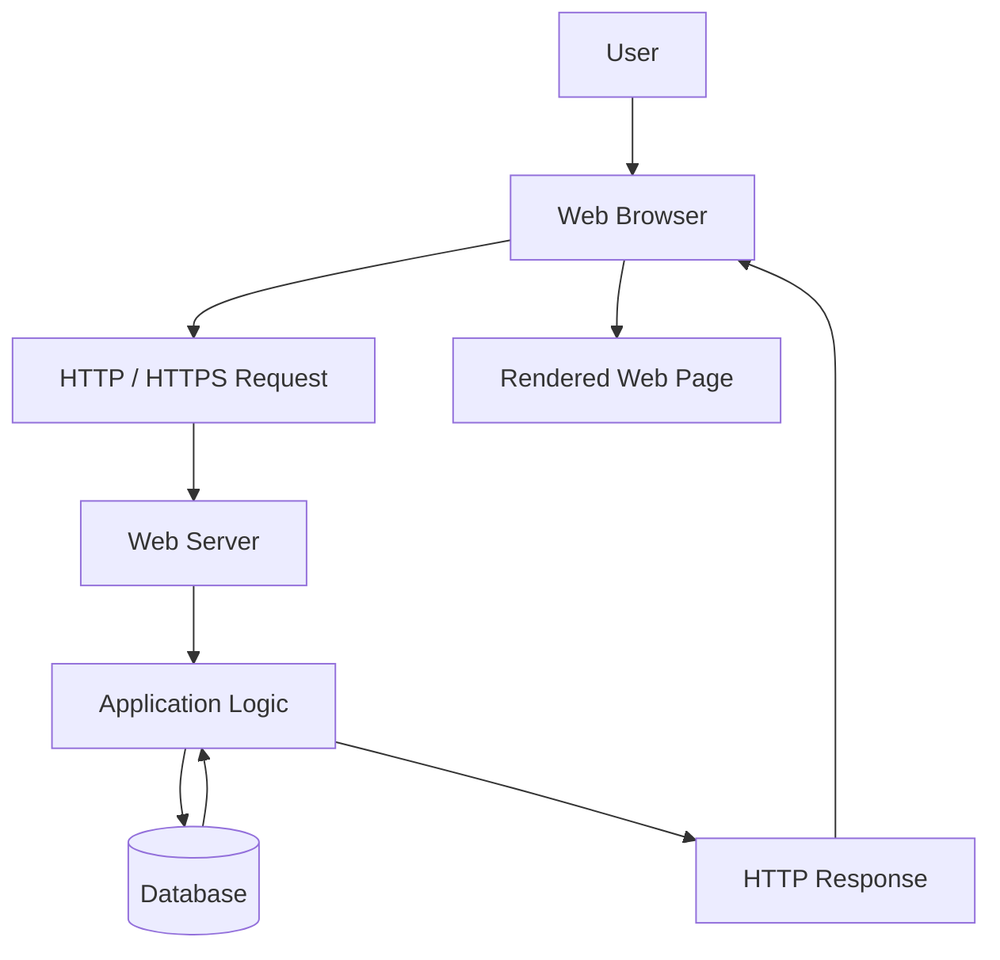
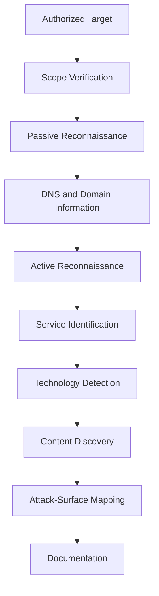
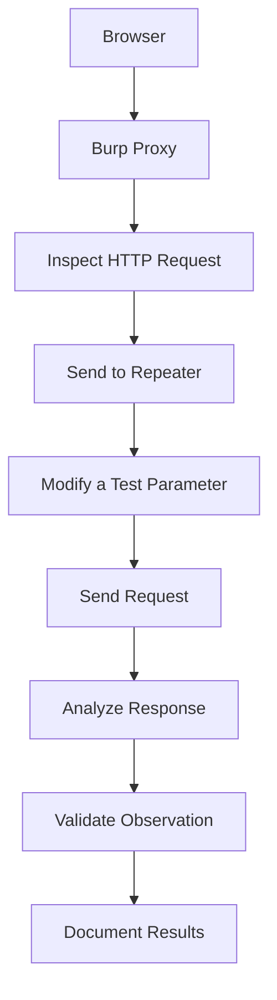
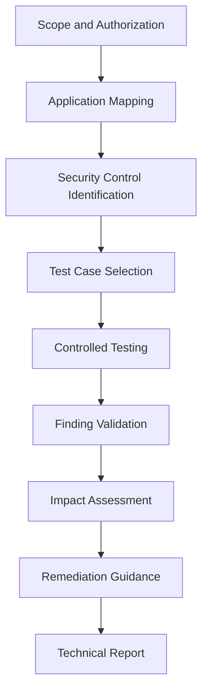

<div align="center">

# 🌐 WEB APPLICATION SECURITY

### Web Application Penetration Testing — Phase 1

**Learn • Understand • Analyze • Test • Secure**

Building a strong foundation in Web Application Security through structured learning, technical documentation, authorized practical labs, and vulnerability analysis.


</div>

---

# 01. About the Project

Welcome to **Web Application Security — WAPT Phase 1**.

This repository documents my learning and practical work in Web Application Penetration Testing (WAPT) as part of my Web Application Penetration Testing internship at IqraSec Academy.

The purpose of this repository is to develop a structured understanding of how web applications operate, how browsers communicate with servers, how application components process user input, and how security professionals identify and validate common web application vulnerabilities.

Web applications are built using multiple components, including client-side interfaces, application logic, web servers, APIs, databases, authentication mechanisms, and access-control systems. Weaknesses in the design, implementation, or configuration of these components can introduce security risks.

Through this learning phase, I am studying the technologies behind web applications and the methodologies used to assess their security.

This repository brings together technical notes, PDF documentation, lab references, tool usage, testing procedures, security observations, and remediation guidance.

## What This Repository Contains

- Web application fundamentals and architecture.
- HTTP and HTTPS communication.
- Client-server request and response analysis.
- DNS fundamentals and web technologies.
- Passive and active reconnaissance.
- DNS enumeration and subdomain discovery.
- Content discovery and attack-surface mapping.
- Burp Suite fundamentals and Repeater.
- Common web application vulnerabilities.
- Practical security-testing references.
- Command-line tools and example commands.
- Vulnerability analysis and remediation guidance.
- Technical documentation and reporting templates.
- References to established web security learning resources.

> **Project status:** This repository documents learning material and practical exercises. A topic appearing in the documentation does not automatically mean that every associated test has been performed or that a vulnerability has been confirmed.

---

# 02. Project Objectives

The primary objective of Phase 1 is to establish a practical foundation in web application security.

## Technical Objectives

1. Understand web application architecture and its major components.
2. Learn the differences between frontend and backend technologies.
3. Understand HTTP and HTTPS communication.
4. Analyze HTTP methods, status codes, headers, cookies, and sessions.
5. Understand DNS resolution and basic domain infrastructure.
6. Learn passive and active reconnaissance methodologies.
7. Identify technologies and services exposed by an authorized target.
8. Understand directory discovery and content enumeration.
9. Learn to intercept and analyze HTTP traffic using Burp Suite.
10. Modify and resend requests using Burp Suite Repeater.
11. Study common web application vulnerability classes.
12. Understand authentication and authorization controls.
13. Learn basic vulnerability validation in controlled environments.
14. Assess potential security impact without unnecessary exploitation.
15. Understand remediation strategies and secure development practices.
16. Develop consistent technical documentation and reporting skills.

## Learning Objectives

By working through this repository, I aim to improve my ability to:

- Explain technical concepts clearly.
- Understand the purpose of security-testing tools.
- Interpret HTTP requests and responses.
- Follow a repeatable testing methodology.
- Distinguish a potential vulnerability from a validated finding.
- Record relevant evidence and testing conditions.
- Explain the root cause and potential impact of a security weakness.
- Recommend appropriate corrective measures.

---

# 03. Web Application Penetration Testing Overview

Web Application Penetration Testing is a structured security-assessment process used to identify and validate weaknesses in web applications within an authorized scope.

A professional assessment is not simply a collection of commands or automated scans. It requires understanding the target application, selecting appropriate test cases, analyzing application behavior, validating observations, and documenting the results.

## General WAPT Methodology

```text
        AUTHORIZED SCOPE
               |
               v
       INFORMATION GATHERING
               |
               v
       RECONNAISSANCE
               |
               v
       APPLICATION MAPPING
               |
               v
       SECURITY TESTING
               |
               v
       FINDING VALIDATION
               |
               v
        IMPACT ANALYSIS
               |
               v
          REMEDIATION
               |
               v
       TECHNICAL REPORTING
```

## Explanation of Each Stage

| Stage | Purpose |
|---|---|
| Scope Definition | Establish authorized targets, boundaries, and testing restrictions. |
| Information Gathering | Collect relevant information about the application and its environment. |
| Reconnaissance | Identify domains, services, technologies, and publicly available information. |
| Application Mapping | Understand pages, endpoints, parameters, workflows, and application functionality. |
| Security Testing | Test relevant security controls and potential vulnerability classes. |
| Finding Validation | Determine whether observed behavior represents a reproducible security weakness. |
| Impact Analysis | Explain the potential confidentiality, integrity, or availability impact. |
| Remediation | Recommend measures to address the underlying weakness. |
| Technical Reporting | Document evidence, reproduction steps, impact, and corrective actions. |

The exact methodology depends on the application, authorization, assessment scope, and testing constraints.

---

# 04. Web Fundamentals

**Objective:** Understand the technologies and communication mechanisms that form the foundation of modern web applications.

## 4.1 What Is a Web Application?

A web application is software accessed through a web browser or another HTTP-capable client.

Examples include online banking portals, e-commerce websites, dashboards, content-management systems, and cloud-based productivity platforms.

A typical web application includes:

- **Client:** The browser or application that initiates requests.
- **Frontend:** The user-facing interface, commonly built with HTML, CSS, and JavaScript.
- **Backend:** The server-side application logic.
- **Web server:** Software that handles HTTP requests and serves or forwards responses.
- **Database:** A system that stores and retrieves application data.
- **API:** An interface through which application components exchange data.
- **Authentication:** Mechanisms used to verify identity.
- **Authorization:** Mechanisms used to control access to resources and operations.

## 4.2 Client-Server Architecture

In a typical client-server model, the client sends a request and the server returns a response.



The database is not necessarily accessed directly by the browser. In a conventional architecture, the backend processes the request and communicates with the database according to application rules.

### Security Relevance

Security testing examines whether the application:

- Validates user input appropriately.
- Enforces authentication and authorization.
- Protects sensitive information.
- Handles sessions securely.
- Prevents unauthorized database operations.
- Returns appropriate error messages.
- Protects sensitive operations against unintended requests.

## 4.3 HTTP and HTTPS

HTTP is an application-layer protocol used for communication between clients and servers.

HTTPS is HTTP carried over TLS, which provides transport encryption and helps authenticate the server.

HTTPS does not automatically make an application secure. Application-level vulnerabilities can still exist when HTTPS is correctly configured.

### Common HTTP Methods

| Method | General Purpose |
|---|---|
| GET | Retrieve a representation of a resource. |
| POST | Submit data or request an operation. |
| PUT | Create or replace a resource representation, depending on the API design. |
| PATCH | Apply a partial modification to a resource. |
| DELETE | Request deletion of a resource. |
| HEAD | Retrieve response headers without the response body. |
| OPTIONS | Discover communication options supported by a resource. |

The actual behavior of a method depends on the application's implementation.

### Common HTTP Status Codes

| Status Code | Meaning |
|---|---|
| 200 OK | The request succeeded. |
| 201 Created | A resource was created successfully. |
| 301 Moved Permanently | The resource has a permanent redirect. |
| 302 Found | A temporary redirect is indicated. |
| 400 Bad Request | The request cannot be processed as submitted. |
| 401 Unauthorized | Authentication is required or has failed. |
| 403 Forbidden | The server refuses the requested operation. |
| 404 Not Found | The requested resource was not found or is not disclosed. |
| 405 Method Not Allowed | The method is not supported for that resource. |
| 429 Too Many Requests | The client has exceeded a rate limit. |
| 500 Internal Server Error | The server encountered an unexpected condition. |
| 503 Service Unavailable | The service is temporarily unavailable. |

A status code alone does not prove that an application is vulnerable. The response must be interpreted in the context of the request, application behavior, and security requirements.

## 4.4 Headers, Cookies, and Sessions

HTTP headers provide metadata about requests and responses.

Cookies allow a server to store or retrieve small pieces of information through a browser. They are frequently used to maintain session identifiers and user preferences.

A session allows an application to associate multiple requests with a user's authenticated state.

Important security considerations include:

- Secure session identifier generation.
- Session expiration and invalidation.
- Protection against session fixation.
- Appropriate cookie security attributes.
- Server-side authorization checks.
- Avoiding sensitive information in URLs.
- Preventing session identifiers from being exposed unnecessarily.

Common cookie attributes include:

| Attribute | Purpose |
|---|---|
| Secure | Restricts cookie transmission to secure HTTPS connections. |
| HttpOnly | Prevents ordinary client-side JavaScript from reading the cookie. |
| SameSite | Controls when browsers send cookies in cross-site contexts. |
| Path | Limits the URL paths for which the cookie is sent. |
| Domain | Defines the hosts to which the cookie applies. |
| Expires / Max-Age | Controls cookie persistence. |

---

# 05. Reconnaissance and Enumeration

**Objective:** Understand how security professionals identify the exposed attack surface of an authorized web application.

Reconnaissance collects information about a target. Enumeration examines discovered assets and services to understand their characteristics.

The techniques used depend on the assessment scope and the level of authorization provided.

## 5.1 Passive Reconnaissance

Passive reconnaissance uses existing information without directly probing the target application in the same way as active scanning.

Examples include:

- Public DNS records.
- Certificate transparency information.
- Public documentation.
- Search-engine results.
- Publicly available technology information.
- Organization-owned repositories and published assets.

Passive techniques can still have privacy, contractual, or scope considerations. Follow the engagement rules.

## 5.2 Active Reconnaissance

Active reconnaissance involves sending requests or probes to authorized systems.

Examples include:

- DNS queries.
- Port and service discovery.
- HTTP response inspection.
- Technology identification.
- Directory and content discovery.
- Application endpoint enumeration.

Active testing can generate logs, trigger defensive controls, or affect application performance. Apply appropriate rate limits and testing restrictions.

## 5.3 Reconnaissance Workflow



## 5.4 Reconnaissance Tools

| Tool | Primary Purpose |
|---|---|
| Nmap | Network discovery and port/service identification. |
| Subfinder | Passive subdomain discovery. |
| DNSx | DNS resolution and related DNS operations. |
| WhatWeb | Web technology identification. |
| Gobuster | Directory, file, and DNS enumeration, depending on mode. |
| Katana | Web crawling and endpoint discovery. |
| Nuclei | Template-based checks for known exposures and security conditions. |
| Nikto | Web server security checks. |
| curl | HTTP requests and response inspection. |
| Browser DevTools | Inspect browser behavior, network requests, storage, and frontend code. |

Tool output must be interpreted carefully. Discovery does not automatically establish exploitability or business impact.

## 5.5 Basic Command Examples

The following examples use localhost or the reserved example domain where practical. Run active testing only against authorized systems.

### Nmap — Service Discovery

```bash
nmap -sV 127.0.0.1
```

**Explanation:**

- `nmap` launches the network scanner.
- `-sV` attempts to identify service versions.
- `127.0.0.1` refers to the local host.

Service-version detection can generate additional traffic. Use it only within the permitted scope.

### Subfinder — Subdomain Discovery

```bash
subfinder -d example.com -silent
```

**Explanation:**

- `-d` specifies the domain.
- `-silent` suppresses some informational output.

The reserved `example.com` domain is illustrative. Replace it only with a domain you are authorized to assess.

### DNSx — DNS Resolution

```bash
echo "example.com" | dnsx -silent
```

This sends the domain to DNSx through standard input for DNS resolution.

### WhatWeb — Technology Identification

```bash
whatweb http://127.0.0.1:3000
```

This inspects a locally hosted web application for detectable technologies and related information.

### Gobuster — Directory Discovery

```bash
gobuster dir \
  -u http://127.0.0.1:3000 \
  -w /usr/share/wordlists/dirb/common.txt
```

**Parameters:**

- `dir`: Directory/file discovery mode.
- `-u`: Target URL.
- `-w`: Wordlist path.

Ensure that the local application is running and that the wordlist exists before executing the command.

### Katana — Web Crawling

```bash
katana -u http://127.0.0.1:3000 -d 2
```

The `-d 2` option limits crawl depth to two levels.

### Nuclei — Template-Based Checks

```bash
nuclei -u http://127.0.0.1:3000
```

Nuclei performs checks using its configured templates. Review the templates and target scope before running a scan.

A reported match should be validated before being treated as a confirmed vulnerability.

### Nikto — Web Server Checks

```bash
nikto -h http://127.0.0.1:3000
```

This runs web-server checks against the specified local target.

---

# 06. Burp Suite

**Objective:** Understand HTTP interception, request modification, and response analysis using Burp Suite.

Burp Suite is a web application security testing platform that helps testers inspect and manipulate application traffic.

It is particularly useful for understanding how an application processes parameters, cookies, headers, authentication state, and user-controlled input.

## 6.1 Important Features

| Feature | Purpose |
|---|---|
| Proxy | Intercept and inspect HTTP/S traffic. |
| Repeater | Modify and resend requests manually. |
| Intruder | Automate customized request testing. |
| Decoder | Encode and decode supported data formats. |
| Comparer | Compare requests or responses. |
| Logger | Review captured HTTP traffic, depending on the version and configuration. |

Available features can differ between Burp Suite editions and versions.

## 6.2 Burp Suite Testing Workflow



## 6.3 Basic Testing Procedure

1. Open Burp Suite.
2. Configure the browser to route traffic through Burp.
3. Install and configure the Burp CA certificate if HTTPS interception requires it.
4. Open an authorized test application.
5. Generate a normal application request.
6. Inspect the request method, path, parameters, headers, and cookies.
7. Send the request to Repeater.
8. Modify one relevant test parameter at a time.
9. Resend the request.
10. Compare the response with the original request.
11. Determine whether the observed behavior is expected.
12. Record evidence and relevant conclusions.

## 6.4 What to Analyze

When examining a request and response, consider:

- HTTP method and endpoint.
- Query parameters and request body.
- Authentication cookies and session state.
- Authorization-related parameters.
- Response status and headers.
- Response body and application error messages.
- Differences between authorized and unauthorized requests.
- Whether the application enforces security controls server-side.

**Important:** A changed response does not necessarily prove a vulnerability. Confirm the behavior against the application's intended security requirements.

---

# 07. Common Web Application Vulnerabilities

This section introduces common vulnerability classes, their causes, potential impact, basic testing considerations, and remediation approaches.

The examples are intended for controlled learning environments.

## 7.1 Authentication Vulnerabilities

Authentication verifies the identity of a user.

Weak authentication controls can allow unauthorized access to accounts or expose sensitive application functionality.

### Testing Considerations

- Login validation.
- Password-reset workflows.
- Session creation and invalidation.
- Account lockout or rate limiting.
- Multi-factor authentication.
- Session-cookie attributes.
- Authentication error handling.
- Password storage and recovery processes.

### Example Request

```bash
curl -i http://127.0.0.1:3000/login
```

Example form submission:

```bash
curl -i -X POST \
  -d "username=testuser&password=testpass" \
  http://127.0.0.1:3000/login
```

These requests illustrate basic HTTP interaction. They do not establish whether the endpoint exists or whether authentication is vulnerable.

### Remediation

- Use established authentication libraries.
- Store passwords using appropriate password-hashing algorithms.
- Apply rate limiting and account-protection controls.
- Implement multi-factor authentication where appropriate.
- Regenerate session identifiers after authentication.
- Invalidate sessions correctly during logout and account-security events.
- Avoid revealing unnecessary information through authentication errors.

## 7.2 Broken Access Control

Broken Access Control occurs when an application allows a user to perform actions or access resources outside their authorized permissions.

Examples may include unauthorized access to administrative functionality, other users' records, or restricted API operations.

### Testing Considerations

- Access to protected endpoints.
- Role-based permissions.
- Ownership checks.
- Server-side authorization.
- Access to administrative functions.
- Authorization consistency across API methods.

### Example Request

```bash
curl -i http://127.0.0.1:3000/admin
```

An HTTP response alone cannot establish whether access control is correctly implemented. Evaluate the response using authorized test accounts and the expected permission model.

### Remediation

- Enforce authorization on the server.
- Deny access by default.
- Validate permissions for every protected operation.
- Separate authentication from authorization.
- Test permissions across roles and resource ownership.
- Avoid relying on frontend restrictions as the primary security control.

## 7.3 Command Injection

Command Injection occurs when untrusted input is incorporated into an operating-system command in an unsafe way.

The impact depends on the application's privileges, the execution environment, and the operations available to the process.

### Testing Considerations

- Identify functionality that invokes operating-system commands.
- Understand how user input reaches the relevant component.
- Use harmless, controlled test cases.
- Observe application behavior and error handling.
- Confirm findings without causing unnecessary system changes.

### Illustrative Lab Input

```text
127.0.0.1; id
```

This is an example of shell metacharacter behavior, not a universally applicable payload. It should be evaluated only in an intentionally vulnerable lab designed for this exercise.

### Remediation

- Avoid shell execution when a safe library API is available.
- Use structured process-execution APIs.
- Avoid constructing commands through string concatenation.
- Apply strict input validation.
- Run services with least privilege.
- Restrict operating-system permissions and process capabilities.

## 7.4 Cross-Site Request Forgery (CSRF)

CSRF attempts to cause a user's browser to submit an unwanted request to an application where the user is authenticated.

The attack generally depends on the application's request handling and the browser's credential behavior.

### Testing Considerations

1. Identify a state-changing request.
2. Understand how the application authenticates the request.
3. Check whether anti-CSRF protections are present.
4. Evaluate token validation and token binding.
5. Review cookie `SameSite` settings.
6. Examine Origin or Referer validation where appropriate.
7. Verify whether an unauthorized cross-site request is rejected.

### Remediation

- Use properly validated CSRF tokens where appropriate.
- Configure suitable `SameSite` cookie attributes.
- Validate request origins for sensitive operations where appropriate.
- Require appropriate reauthentication for high-risk actions.
- Do not treat CORS configuration as a replacement for CSRF protection.

## 7.5 File Inclusion and Path Traversal

File inclusion and path traversal are related but distinct vulnerability classes.

**Path traversal** occurs when an attacker can manipulate a path to access files outside the intended directory.

**File inclusion** occurs when an application improperly includes or processes a user-controlled file reference. Depending on the technology and implementation, this can have consequences beyond unauthorized file access.

### Illustrative Lab Input

```text
../../../../etc/passwd
```

This input demonstrates directory traversal syntax on Unix-like systems. Whether it has any effect depends on the application's implementation and environment.

### Testing Considerations

- Identify file-related parameters.
- Understand the application's expected file-access behavior.
- Test path normalization and directory restrictions.
- Check whether unauthorized files can be accessed.
- Avoid accessing sensitive data outside the approved test scope.

### Remediation

- Prefer server-controlled identifiers over arbitrary filesystem paths.
- Use strict file allowlists.
- Canonicalize and validate paths.
- Enforce access restrictions after path resolution.
- Restrict application filesystem permissions.
- Avoid exposing unnecessary filesystem information.

## 7.6 Insecure Direct Object Reference (IDOR)

IDOR is a type of access-control weakness in which an application exposes a reference to an object but fails to enforce the required authorization check.

An identifier can be numeric, textual, or otherwise structured. Changing an identifier alone does not prove that an IDOR exists.

### Example Endpoints

```text
GET /api/users/1001
GET /api/users/1002
```

These are illustrative endpoint patterns. Their behavior depends on the application.

### Testing Procedure

1. Use an authorized test account.
2. Identify a resource that the account is permitted to access.
3. Record the normal request.
4. Compare behavior using another test resource or account.
5. Verify whether the application enforces resource ownership.
6. Record only the minimum evidence required to demonstrate the issue.

### Remediation

- Enforce object-level authorization.
- Verify resource ownership on the server.
- Apply consistent checks across API endpoints.
- Avoid relying on unpredictable identifiers as the only security control.
- Include authorization tests in application testing.

## 7.7 SQL Injection

SQL Injection occurs when untrusted input changes the structure or meaning of a database query.

It commonly results from unsafe query construction, particularly when application input is concatenated directly into SQL statements.

### Illustrative Lab Payload

```sql
' OR '1'='1'--
```

This is a basic educational example. Its behavior depends on the database engine, query structure, and comment syntax.

### Example HTTP Request

```bash
curl -i -G \
  --data-urlencode "q=' OR '1'='1'--" \
  http://127.0.0.1:3000/search
```

This command URL-encodes the supplied parameter. It does not guarantee SQL injection or confirm that the endpoint is vulnerable.

### Testing Considerations

- Input handling.
- Database error disclosure.
- Unexpected query behavior.
- Differences between normal and controlled test input.
- Safe validation within an authorized lab.

### Remediation

- Use parameterized queries and prepared statements.
- Avoid constructing SQL through string concatenation.
- Apply least-privilege database permissions.
- Handle database errors safely.
- Validate input according to the application's requirements.

## 7.8 File Upload Vulnerabilities

File upload weaknesses occur when an application fails to validate, store, process, or serve uploaded files securely.

Potential risks depend on how the application handles file contents and where the files are stored.

### Harmless Test File

```bash
echo "WAPT Upload Test" > test.txt
```

### Example Upload Request

```bash
curl -i -X POST \
  -F "file=@test.txt" \
  http://127.0.0.1:3000/upload
```

The endpoint and form-field name are illustrative. Confirm the actual interface of the authorized lab before testing.

### Testing Considerations

- File-extension validation.
- Content-type validation.
- File-content verification.
- File-size restrictions.
- Filename handling.
- Storage location.
- Access permissions.
- Whether uploaded files can be executed or interpreted.

### Remediation

- Validate actual file content, not only the filename or declared MIME type.
- Generate safe filenames.
- Restrict permitted file types and sizes.
- Store uploads outside executable web directories where possible.
- Apply access controls.
- Prevent uploaded content from being interpreted as executable code.
- Scan files where the application's risk model requires it.

## 7.9 Cross-Site Scripting (XSS)

Cross-Site Scripting occurs when untrusted content is handled in a way that allows unintended script execution in a user's browser.

### Main Types

| Type | Description |
|---|---|
| Reflected XSS | Untrusted input is reflected in a response and interpreted unsafely. |
| Stored XSS | Untrusted content is stored and later rendered unsafely. |
| DOM-based XSS | Client-side code processes untrusted data in an unsafe way. |

### Harmless Lab Payload

```html
<script>alert('XSS Test')</script>
```

This example is for an intentionally vulnerable local lab. Whether it executes depends on the rendering context and application defenses.

### Testing Considerations

- Input reflection.
- Output encoding.
- HTML, attribute, URL, and JavaScript contexts.
- Unsafe DOM manipulation.
- Content Security Policy.
- Differences between stored, reflected, and DOM-based behavior.

### Remediation

- Apply context-aware output encoding.
- Use safe DOM APIs.
- Avoid unsafe HTML insertion.
- Validate input according to business requirements.
- Implement Content Security Policy as an additional defensive layer.
- Use secure templating practices.

## 7.10 Additional Vulnerability Classes to Study

The repository's primary documentation index focuses on the topics listed above. The following subjects are useful extensions to a broader WAPT curriculum and should be documented separately as they are studied.

| Topic | Core Security Concern |
|---|---|
| Server-Side Request Forgery (SSRF) | Unauthorized server-side requests to other resources. |
| Server-Side Template Injection (SSTI) | Unsafe evaluation of template expressions. |
| Security Misconfiguration | Insecure application, server, or infrastructure settings. |
| Cryptographic Failures | Inadequate protection of sensitive information. |
| Insecure Deserialization | Unsafe processing of serialized data. |
| API Security | Weaknesses in API authentication, authorization, validation, or data exposure. |
| Business Logic Vulnerabilities | Abuse of application workflows or business rules. |

These additional topics are learning priorities, not claims that corresponding practical tests have already been completed.

---

# 08. Security Tools and Installation

This section provides example installation commands for a Kali Linux or compatible Debian-based environment.

Package availability and installation requirements can vary by distribution, repository configuration, and tool version.

## 8.1 Update the Package Index

```bash
sudo apt update
```

Review package-manager errors before continuing. Do not assume an installation succeeded if the package manager reports a failure.

## 8.2 Install Core Tools

```bash
sudo apt install -y \
  nmap \
  curl \
  git \
  python3 \
  python3-pip \
  nikto \
  gobuster \
  whatweb
```

Burp Suite and OWASP ZAP may require separate installation steps, depending on the distribution and available repositories.

Official documentation:

- Kali Linux: https://www.kali.org/docs/
- Burp Suite: https://portswigger.net/burp/documentation
- OWASP ZAP: https://www.zaproxy.org/docs/

## 8.3 Install Go

```bash
sudo apt install -y golang-go
```

Verify the installation:

```bash
go version
```

## 8.4 Install ProjectDiscovery Tools

Subfinder:

```bash
go install github.com/projectdiscovery/subfinder/v2/cmd/subfinder@latest
```

DNSx:

```bash
go install github.com/projectdiscovery/dnsx/cmd/dnsx@latest
```

Katana:

```bash
go install github.com/projectdiscovery/katana/cmd/katana@latest
```

Nuclei:

```bash
go install github.com/projectdiscovery/nuclei/v3/cmd/nuclei@latest
```

These commands install the respective Go binaries using the Go toolchain. Confirm that the installation instructions remain compatible with your installed Go version.

## 8.5 Configure the Go Binary Path

For the current Bash session:

```bash
export PATH="$PATH:$(go env GOPATH)/bin"
```

To make the change persistent for Bash sessions:

```bash
echo 'export PATH="$PATH:$(go env GOPATH)/bin"' >> ~/.bashrc
source ~/.bashrc
```

## 8.6 Verify Tool Installations

```bash
nmap --version
curl --version
go version
subfinder -version
dnsx -version
katana -version
nuclei -version
```

Check individual tool documentation if a version flag differs between releases.

## 8.7 Create a Working Directory

```bash
mkdir -p ~/WAPT-Lab/{Recon,Burp,Testing,Reports,Screenshots}
```

Navigate into the directory:

```bash
cd ~/WAPT-Lab
```

The working directory separates test output and documentation from unrelated files.

**Operational note:** Install tools only from trusted distribution repositories or their official project sources. Review update requirements and avoid running tools against systems outside the authorized scope.

---

# 09. Practical Learning Environments

Practical testing is most useful when the environment is intentionally designed for security training.

## 9.1 OWASP Juice Shop

OWASP Juice Shop is an intentionally vulnerable web application designed for security education and practical exercises.

It provides an environment for exploring web vulnerabilities, understanding application behavior, and learning remediation concepts.

Official project:

https://owasp.org/www-project-juice-shop/

## 9.2 PortSwigger Web Security Academy

PortSwigger Web Security Academy provides educational material and interactive labs covering many web application vulnerability classes.

It is useful for structured practice in request analysis, authentication, access control, injection vulnerabilities, and other web security topics.

Official website:

https://portswigger.net/web-security

## 9.3 Safe Lab Practices

- Use intentionally vulnerable applications or systems covered by explicit authorization.
- Keep test accounts and lab data separate from personal accounts.
- Record the lab configuration and relevant tool versions.
- Avoid using real user data for testing.
- Keep evidence relevant to the finding.
- Do not assume that a technique permitted in a lab is permitted on a public website.

---

# 10. End-to-End Vulnerability Testing Workflow

A consistent workflow helps reduce missed steps and improves the quality of technical findings.

## Step 1 — Define the Scope

Identify the approved targets, application components, permitted testing methods, and restrictions.

## Step 2 — Understand the Application

Review the application's functionality, endpoints, user roles, authentication requirements, and data flows.

## Step 3 — Map the Attack Surface

Record relevant hosts, services, technologies, pages, API endpoints, parameters, and input locations.

## Step 4 — Identify Security Controls

Understand how the application implements authentication, authorization, session management, input validation, and other relevant controls.

## Step 5 — Select Test Cases

Choose tests appropriate to the application's functionality and the authorized scope.

## Step 6 — Perform Controlled Testing

Use manual inspection and suitable tools to test the selected security controls.

## Step 7 — Validate Observations

Repeat the relevant test, compare against expected behavior, and determine whether the observed result is reproducible.

## Step 8 — Assess Impact

Explain what an attacker could realistically achieve if the weakness were exploited. Consider confidentiality, integrity, availability, and business impact.

## Step 9 — Recommend Remediation

Identify the underlying weakness and recommend a corrective measure that addresses the root cause.

## Step 10 — Document the Finding

Record the affected component, evidence, reproduction steps, impact, remediation, and relevant references.

## Workflow Summary



A scan result should not be presented as a confirmed vulnerability until sufficient validation supports that conclusion.

---

# 11. Vulnerability Remediation Reference

The following table summarizes common defensive measures.

| Vulnerability | Recommended Protection |
|---|---|
| Authentication Weaknesses | Secure password storage, MFA where appropriate, rate limiting, and robust session management. |
| Broken Access Control | Server-side authorization checks and deny-by-default policies. |
| Command Injection | Avoid unsafe shell execution and use safe APIs. |
| CSRF | Appropriate CSRF tokens, cookie settings, and request validation. |
| File Inclusion | Strict file allowlists, safe path handling, and least privilege. |
| IDOR | Object-level authorization and ownership validation. |
| SQL Injection | Parameterized queries and prepared statements. |
| File Upload Weaknesses | Content validation, safe filenames, restricted storage, and access controls. |
| XSS | Context-aware output encoding and safe DOM APIs. |
| Security Misconfiguration | Secure defaults, configuration reviews, and removal of unnecessary services. |
| SSRF | Restrict outbound requests and validate destinations using robust server-side controls. |
| SSTI | Avoid unsafe evaluation of user-controlled template expressions. |

The correct mitigation depends on the root cause and application architecture.

---

# 12. Vulnerability Reporting Format

A technical report should allow another authorized tester or developer to understand the finding, reproduce it safely, evaluate its impact, and implement a fix.

Use the following template for validated findings.

```text
VULNERABILITY REPORT

1. Finding Title:

2. Vulnerability Category:

3. Finding ID:

4. Severity:

5. Affected Application:

6. Affected Endpoint:

7. HTTP Method:

8. Testing Environment:

9. Preconditions:

10. Description:

11. Root Cause:

12. Steps to Reproduce:

13. Request and Response Evidence:

14. Screenshots or Supporting Artifacts:

15. Observed Behavior:

16. Expected Behavior:

17. Security Impact:

18. Likelihood and Risk Assessment:

19. Recommended Remediation:

20. Retesting Procedure:

21. References:

22. Testing Date:
```

## Reporting Guidelines

### Finding Title

Use a concise title describing the actual weakness.

### Severity

Assign severity using an appropriate, documented methodology. Consider exploitability, required privileges, affected data, and business impact.

Do not assign a high severity merely because a vulnerability class sounds dangerous.

### Evidence

Include only the evidence necessary to establish the finding. Remove credentials, session tokens, personal information, and unrelated sensitive data.

### Reproduction Steps

Provide ordered steps that another authorized tester can follow in the same environment.

### Impact

Explain the realistic consequence rather than making unsupported claims.

### Remediation

Recommend a fix that addresses the underlying cause. Include configuration changes, code-level controls, or architectural improvements where relevant.

### Retesting

Describe how the corrected application should be tested to confirm that the weakness has been resolved.

**Important:** Only report vulnerabilities that have actually been tested and validated. Clearly label theoretical risks, unverified scanner output, and incomplete test cases.

---

# 13. Learning Outcomes

Phase 1 focuses on developing the knowledge and working habits needed for further web application security training.

The intended learning outcomes include:

- Understanding web application architecture.
- Explaining client-server communication.
- Reading HTTP requests and responses.
- Understanding HTTP methods, headers, cookies, and sessions.
- Performing basic reconnaissance in authorized environments.
- Understanding DNS enumeration and content discovery.
- Using command-line tools for security assessment.
- Intercepting and analyzing traffic with Burp Suite.
- Understanding common web vulnerability classes.
- Identifying authentication and authorization concerns.
- Distinguishing an observation from a validated finding.
- Understanding vulnerability root causes and potential impacts.
- Recommending suitable remediation measures.
- Preparing clear technical documentation.

These are learning objectives. Individual skills should be considered demonstrated only when supported by completed exercises, evidence, or practical assessment.

---

# 14. Repository Structure

The repository is organized into four main learning areas.

```text
Web-Application-Basics/
│
├── README.md
│
├── assets/
│   └── wapt-security.gif
│
├── 1.Web-Fundamentals/
│   ├── Room1_Web-Application-Basics/
│   │   └── Room1_Web-Application-Basics.pdf
│   │
│   └── Room2_HTTP-in-Detail/
│       └── Room2_HTTP-in-Detail.pdf
│
├── 2.Recon-Enumeration/
│   ├── Room1_Passive-Recon/
│   │   └── Room1_Passive-Recon.pdf
│   │
│   ├── Room2_Active-Recon/
│   │   └── Room2_Active-Recon.pdf
│   │
│   └── Room3_Content-Discovery/
│       └── Room3_Content-Discovery.pdf
│
├── 3.Burp-Suite/
│   └── Room1_Burp-Suite-Repeater/
│       └── Room1_Burp-Suite-Repeater.pdf
│
└── 4.Common-Web-Vulnerabilities/
    │
    ├── Authentication-Access-Control/
    ├── Broken Access Control/
    ├── Command Injection/
    ├── CSRF intro/
    ├── File Inclusion/
    ├── IDOR/
    ├── OWASP JUICE SHOP/
    ├── PortSwigger-Lab/
    ├── SQL-Injection/
    ├── Upload Vulnerabilities/
    └── XSS/
```

**Repository note:** This is a documentation-oriented directory map. Confirm actual filenames and nested paths in GitHub before relying on the example tree. Add report and screenshot subdirectories only where they exist.

---

# 15. References and Official Resources

The following resources provide additional technical explanations, testing methodologies, and documentation.

| Resource | Purpose | Official Website |
|---|---|---|
| OWASP Top 10 | Awareness of major web application security risks. | https://owasp.org/www-project-top-ten/ |
| OWASP Web Security Testing Guide | Structured web application security testing guidance. | https://owasp.org/www-project-web-security-testing-guide/ |
| OWASP Juice Shop | Intentionally vulnerable training application. | https://owasp.org/www-project-juice-shop/ |
| PortSwigger Web Security Academy | Web security training and interactive labs. | https://portswigger.net/web-security |
| MDN Web Docs | Web technologies, HTTP, JavaScript, and browser behavior. | https://developer.mozilla.org/ |
| Nmap Documentation | Network discovery and service identification. | https://nmap.org/book/man.html |
| Burp Suite Documentation | Web application testing tools and workflows. | https://portswigger.net/burp/documentation |
| Nuclei Documentation | Template-based security scanning. | https://docs.projectdiscovery.io/tools/nuclei |
| Kali Linux Documentation | Installation, configuration, and tool guidance. | https://www.kali.org/docs/ |

Prefer official documentation when verifying tool syntax, installation requirements, and recommended testing practices.

---

# 16. Security and Responsible Testing Disclaimer

This repository is intended for educational purposes and authorized cybersecurity training.

All active security testing must be performed on systems that I own, intentionally vulnerable training environments, or systems for which explicit authorization has been obtained.

Testing must remain within the approved scope and comply with applicable rules and restrictions.

The following activities are not authorized by this repository:

- Unauthorized access to systems or accounts.
- Accessing other users' private information.
- Testing public systems without permission.
- Disrupting services or modifying production data without authorization.
- Using discovered credentials or session tokens outside the approved test.
- Exfiltrating sensitive information.
- Performing destructive testing outside a specifically approved environment.

Commands and payloads are learning references. Their inclusion does not establish that a target is vulnerable.

Security tools can produce false positives, false negatives, and incomplete results. Findings must be evaluated in context and validated before being reported as confirmed vulnerabilities.

---

# 17. Internship Information

| Detail | Information |
|---|---|
| Organization | IqraSec Academy |
| Internship | Web Application Penetration Testing |
| Domain | Cybersecurity |
| Phase | Phase 1 — Learning and Foundation |
| Internship Start Date | 15 October 2026 |
| Internship End Date | 14 November 2026 |
| Duration | 1 Month |
| Submission Period | 1 November – 5 November 2026 |
| Repository | Web-Application-Basics |
| GitHub Profile | GhostMaskR |

This repository serves as a structured record of learning material and practical work associated with the internship.

The listed dates describe the internship schedule. They do not independently establish completion of every learning objective or testing activity.

---

# 18. Conclusion

Web application security requires more than knowing vulnerability names or memorizing payloads. It requires understanding how an application works, how its security controls are intended to operate, and how to validate weaknesses through controlled testing.

Through this repository, I am building a foundation in web technologies, reconnaissance, HTTP traffic analysis, Burp Suite, common vulnerability classes, security remediation, and technical reporting.

My focus is on understanding the underlying security principles, documenting practical observations accurately, and developing a repeatable methodology that can support more advanced penetration-testing work in the future.

This is an evolving learning repository. Its documentation and practical evidence will develop as additional exercises are completed and validated.

<div align="center">

### GHOSTMASKR | WEB APPLICATION SECURITY

**LEARN • ANALYZE • TEST • SECURE**

*Building a stronger foundation in Web Application Penetration Testing.*

</div>
