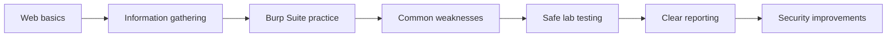
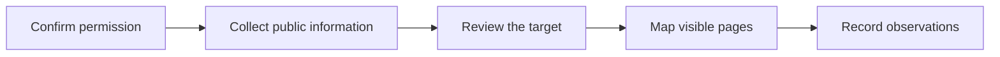

<div align="center">


# Web Application Security
### WAPT Phase 1 — Learning Portfolio


[](https://github.com/GhostMaskR/Web-Application-Basics/commits/main)
[](https://github.com/GhostMaskR/Web-Application-Basics)

**Learn with care. Test with permission. Document what you find.**

</div>

---

## About this repository

This repository records my first learning phase in **web application penetration testing** at **IqraSec Academy**.

The work starts with the basics: how a website works, how a browser communicates with a server, and how information moves through an application. It then moves into information gathering, Burp Suite practice, and common web security weaknesses.

The aim is not just to collect notes. It is to build a clear and responsible way of thinking:

- Understand how an application is expected to work.
- Notice where its behaviour may be unsafe.
- Test only in a permitted environment.
- Explain the result in simple, useful language.
- Suggest practical ways to improve security.

## What is included

- Learning reports in PDF format.
- Screenshots and completion links from the study rooms.
- Web fundamentals and HTTP basics.
- Passive and active information gathering.
- Burp Suite Repeater practice.
- Guided practice with common web security issues.
- Testing checklists and safer coding suggestions.
- A simple format for writing findings.

## Learning path



---

## 1. Web fundamentals

This section explains the main parts of a web application and how they work together.

| Study room | What I learned | Report |
|---|---|---|
| Web Application Basics | Browsers, servers, pages, databases, and the flow of a request | [Open report](1.Web-Fundamentals/Room1_Web-Application-Basics/Report.pdf) |
| HTTP in Detail | Requests, responses, methods, headers, cookies, and status codes | [Open report](1.Web-Fundamentals/Room2_HTTP-in-Detail/Report.pdf) |

### Main ideas

- The difference between a browser and a server.
- How a request is sent and how a response is returned.
- The role of pages, application logic, and data storage.
- Why cookies and sessions matter.
- How status codes help explain what happened.

---

## 2. Information gathering

Before testing an application, it is important to understand what is publicly visible and how the application is organised. This section covers that process in authorised lab environments.

| Study room | What I learned | Report |
|---|---|---|
| Passive Recon | Learning from information already available | [Open report](2.Recon-Enumeration/Room1_Passive-Recon/Report.pdf) |
| Active Recon | Carefully interacting with an authorised target | [Open report](2.Recon-Enumeration/Room2_Active-Recon/Report.pdf) |
| Content Discovery | Finding pages and resources that belong to a test application | [Open report](2.Recon-Enumeration/Room3_Content-Discovery/Report.pdf) |

### A responsible process



### Tools studied

The reports introduce tools such as Nmap, Subfinder, DNSx, WhatWeb, Gobuster, Katana, Nuclei, Nikto, curl, and browser developer tools. They are included for learning and should be used only against systems that are owned by you or covered by written permission.

---

## 3. Burp Suite practice

This section focuses on reading and changing web requests in a safe practice application.

| Study room | What I learned | Report |
|---|---|---|
| Burp Suite Repeater | Sending a request again after making a controlled change | [Open report](3.Burp-Suite/Room1_Burp-Suite-Repeater/Report.pdf) |

### Practice flow

1. Open a permitted practice application.
2. Capture a request through the browser proxy.
3. Send a copy to Repeater.
4. Change one value at a time.
5. Compare the response with the original.
6. Record only verified observations.

---

## 4. Common web security weaknesses

These reports introduce common weaknesses, how they can appear in a lab, and how developers can reduce the risk.

| Topic | Report |
|---|---|
| Authentication and access control | [Open report](4.Common-Web-Vulnerabilities/Authentication-Access-Control/Report.pdf) |
| Broken access control | [Open report](4.Common-Web-Vulnerabilities/Broken%20Access%20Control/Report.pdf) |
| Command injection | [Open report](4.Common-Web-Vulnerabilities/Command%20Injection/Report.pdf) |
| Cross-site request forgery (CSRF) | [Open report](4.Common-Web-Vulnerabilities/CSRF%20intro/Report.pdf) |
| File inclusion | [Open report](4.Common-Web-Vulnerabilities/File%20Inclusion/Report.pdf) |
| Insecure direct object references (IDOR) | [Open report](4.Common-Web-Vulnerabilities/IDOR/Report.pdf) |
| OWASP Juice Shop practice | [Open report](4.Common-Web-Vulnerabilities/OWASP%20JUICE%20SHOP/Report.pdf) |
| PortSwigger practice labs | [Open report](4.Common-Web-Vulnerabilities/PortSwigger-Lab/Report.pdf) |
| SQL injection | [Open report](4.Common-Web-Vulnerabilities/SQL-Injection/Report.pdf) |
| Unsafe file uploads | [Open report](4.Common-Web-Vulnerabilities/Upload%20Vulnerabilities/Report.pdf) |
| Cross-site scripting (XSS) | [Open report](4.Common-Web-Vulnerabilities/XSS/Report.pdf) |

### What each topic tries to answer

- What should the application do?
- What happens when input or permissions are handled incorrectly?
- What evidence can be safely collected in a lab?
- What could the issue affect?
- What change would make the application safer?

### Safer development reminders

| Area | Good practice |
|---|---|
| Login and sessions | Use strong password storage, secure cookies, and account protection |
| Permissions | Check permissions on the server for every protected action |
| User input | Validate input and use safe built-in functions |
| Database queries | Use prepared statements instead of joining raw input to a query |
| File uploads | Check content, size, name, and storage location |
| Browser output | Encode untrusted text for the place where it is displayed |
| Cross-site requests | Use request tokens and suitable cookie settings |

---

## Practice environments

The following platforms are designed for learning and guided practice:

- [OWASP Juice Shop](https://owasp.org/www-project-juice-shop/)
- [PortSwigger Web Security Academy](https://portswigger.net/web-security)

They are safer choices than testing an unknown public website. Even on a lab platform, follow its rules and stay within the intended exercise.

---

## Finding report template

When I record a finding, I use the following structure:

```text
Finding title:
Issue type:
Affected page or request:
Test environment:
Severity:
What I observed:
Steps followed:
Evidence:
Possible impact:
Likely cause:
Suggested improvement:
References:
```

A report should describe what was actually tested. It should not claim a result that was not verified.

---

## Repository structure

```text
Web-Application-Basics/
├── README.md
├── 1.Web-Fundamentals/
│   ├── Room1_Web-Application-Basics/
│   └── Room2_HTTP-in-Detail/
├── 2.Recon-Enumeration/
│   ├── Room1_Passive-Recon/
│   ├── Room2_Active-Recon/
│   └── Room3_Content-Discovery/
├── 3.Burp-Suite/
│   └── Room1_Burp-Suite-Repeater/
└── 4.Common-Web-Vulnerabilities/
    ├── Authentication-Access-Control/
    ├── Broken Access Control/
    ├── Command Injection/
    ├── CSRF intro/
    ├── File Inclusion/
    ├── IDOR/
    ├── OWASP JUICE SHOP/
    ├── PortSwigger-Lab/
    ├── SQL-Injection/
    ├── Upload Vulnerabilities/
    └── XSS/
```

Every study room may include a report, screenshots, and a completion-links file.

---

## What I learned

By completing this phase, I built a stronger understanding of:

- How web applications communicate.
- How to read basic requests and responses.
- How to gather information responsibly.
- How to review an application with Burp Suite.
- How common security weaknesses affect users and applications.
- How to write clear notes and evidence-based reports.
- Why permission and safe practice are essential.

---

## References

- [OWASP Top 10](https://owasp.org/www-project-top-ten/)
- [OWASP Web Security Testing Guide](https://owasp.org/www-project-web-security-testing-guide/)
- [OWASP Juice Shop](https://owasp.org/www-project-juice-shop/)
- [PortSwigger Web Security Academy](https://portswigger.net/web-security)
- [MDN Web Docs](https://developer.mozilla.org/)
- [Burp Suite Documentation](https://portswigger.net/burp/documentation)

---

## Disclaimer

This repository is for education and authorised practice only.

Test only your own systems, intentionally vulnerable training applications, or systems for which you have clear written permission. Do not use the examples in this repository to access, damage, interrupt, or collect data from another person's system.

The presence of an example or command does not prove that a particular application is vulnerable. Always follow the rules of the platform and stop testing if permission is unclear.

---

## Internship details

| Detail | Information |
|---|---|
| Organisation | IqraSec Academy |
| Programme | Web Application Penetration Testing |
| Phase | Phase 1 — Learning and Foundation |
| Submission period | 1 November – 5 November 2026 |
| GitHub profile | [GhostMaskR](https://github.com/GhostMaskR) |

<div align="center">


**Learn • Understand • Practice • Improve**

</div>
