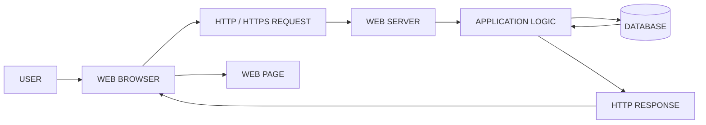
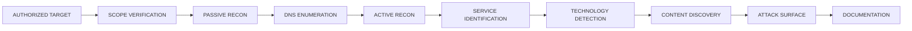
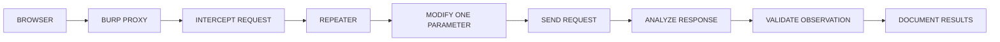

<div align="center">


# 🌐 WEB APPLICATION SECURITY
### WAPT PHASE 1 — LEARNING & FOUNDATION

**Learn • Understand • Analyze • Test • Secure**

Building a strong foundation in Web Application Security through structured learning, technical documentation, authorized practical labs, and vulnerability analysis.


</div>

---

## 📑 Table of Contents

1. [About the Project](#-01-about-the-project)
2. [Project Objectives](#-02-project-objectives)
3. [WAPT Overview & Roadmap](#-03-wapt-overview--learning-roadmap)
4. [Web Fundamentals](#-04-web-fundamentals)
5. [Reconnaissance & Enumeration](#-05-reconnaissance--enumeration)
6. [Burp Suite](#-06-burp-suite)
7. [Common Web Vulnerabilities](#-07-common-web-application-vulnerabilities)
8. [Security Tools Installation](#-08-security-tools-installation-guide)
9. [Practical Learning Environments](#-09-practical-learning-environments)
10. [End-to-End Testing Workflow](#-10-end-to-end-vulnerability-testing-workflow)
11. [Remediation Reference](#-11-vulnerability-remediation-reference)
12. [Severity & Risk Rating](#-12-severity--risk-rating-reference)
13. [Vulnerability Reporting Format](#-13-vulnerability-reporting-format)
14. [Lab Progress Tracker](#-14-lab-progress-tracker)
15. [Quick Cheat Sheet](#-15-quick-cheat-sheet)
16. [Glossary](#-16-glossary)
17. [Learning Outcomes](#-17-learning-outcomes)
18. [Repository Structure](#-18-repository-structure)
19. [References](#-19-references--official-resources)
20. [Legal & Responsible Testing Disclaimer](#-20-legal--responsible-testing-disclaimer)
21. [Internship Information](#-21-internship-information)
22. [Next Steps](#-22-next-steps-planned)
23. [Author](#-23-author)
24. [Conclusion](#-24-conclusion)
25. [Appendix A — Tracker Script](#-appendix-a--tracker-auto-update-script)

---

# 📌 01. ABOUT THE PROJECT

Welcome to **Web Application Security — WAPT Phase 1**.

This repository documents my learning and practical work in Web Application Penetration Testing (WAPT) as part of my internship at **IqraSec Academy**.

The goal is to build a structured understanding of how web applications work, how browsers and servers communicate, how application components process user input, and how security professionals identify and validate common web vulnerabilities.

Web applications are made of multiple components: client-side interfaces, application logic, web servers, APIs, databases, authentication mechanisms, and access-control systems. A weakness in the design, implementation, or configuration of any of these can introduce security risk.

## What This Repository Contains

- Structured PDF documentation for every room and lab.
- Web application fundamentals and architecture.
- HTTP and HTTPS communication analysis.
- Passive and active reconnaissance, DNS and subdomain enumeration.
- Content discovery and attack-surface mapping.
- Burp Suite fundamentals and Repeater.
- Common web application vulnerabilities, with root causes and fixes.
- Command-line tools with example commands.
- Workflow diagrams, reporting templates, and remediation guidance.
- Lab progress tracking and a quick-reference cheat sheet.

**Designed for:** cybersecurity students, beginners, and aspiring Web Application Penetration Testers.

> **Project status:** This repository documents learning material and practical exercises. A topic appearing here does **not** automatically mean every associated test was performed or that a vulnerability was confirmed. See the [Lab Progress Tracker](#-14-lab-progress-tracker) for what is actually completed.

---

# 🎯 02. PROJECT OBJECTIVES

## Technical Objectives

1. Understand web application architecture and its major components.
2. Learn the differences between frontend and backend technologies.
3. Understand HTTP and HTTPS communication.
4. Analyze HTTP methods, status codes, headers, cookies, and sessions.
5. Understand DNS resolution and basic domain infrastructure.
6. Learn passive and active reconnaissance methodologies.
7. Identify technologies and services exposed by an authorized target.
8. Understand directory discovery and content enumeration.
9. Intercept and analyze HTTP traffic using Burp Suite.
10. Modify and resend requests using Burp Suite Repeater.
11. Study common web application vulnerability classes.
12. Understand authentication and authorization controls.
13. Perform basic vulnerability validation in controlled environments.
14. Assess potential impact without unnecessary exploitation.
15. Understand remediation strategies and secure development practices.
16. Develop consistent technical documentation and reporting skills.

## Learning Objectives

By working through this repository, I aim to:

- Explain technical concepts clearly.
- Understand the purpose of each security-testing tool.
- Interpret HTTP requests and responses.
- Follow a repeatable testing methodology.
- Distinguish a **potential vulnerability** from a **validated finding**.
- Record evidence and testing conditions.
- Explain root cause and impact of a weakness.
- Recommend appropriate corrective measures.

---

# 🗺️ 03. WAPT OVERVIEW & LEARNING ROADMAP

Web Application Penetration Testing is a structured process used to identify and validate weaknesses in web applications **within an authorized scope**.

A professional assessment is not a collection of commands or an automated scan. It requires understanding the target, choosing appropriate test cases, analyzing behavior, validating observations, and documenting results.

## Learning Roadmap


## General WAPT Methodology

| Stage | Purpose |
|---|---|
| Scope Definition | Establish authorized targets, boundaries, and restrictions. |
| Information Gathering | Collect information about the application and its environment. |
| Reconnaissance | Identify domains, services, technologies, and public information. |
| Application Mapping | Understand pages, endpoints, parameters, workflows, and functionality. |
| Security Testing | Test relevant security controls and vulnerability classes. |
| Finding Validation | Determine whether behavior is a reproducible weakness. |
| Impact Analysis | Explain confidentiality, integrity, and availability impact. |
| Remediation | Recommend measures that fix the root cause. |
| Technical Reporting | Document evidence, reproduction steps, impact, and fixes. |

The exact methodology depends on the application, authorization, scope, and testing constraints.

---

# 🌐 04. WEB FUNDAMENTALS

**Objective:** Understand the structure, technologies, and communication mechanisms of web applications.

## 📄 Documentation

| Room | Topic | Documentation |
|---|---|---|
| Room 01 | Web Application Basics | [View PDF](Rohit_WAPT_Phase-1/1.Web-Fundamentals/Room1_Web-Application-Basics/Room1_Web-Application-Basics.pdf) |
| Room 02 | HTTP in Detail | [View PDF](Rohit_WAPT_Phase-1/1.Web-Fundamentals/Room2_HTTP-in-Detail/Room2_HTTP-in-Detail.pdf) |

## 4.1 What Is a Web Application?

Software accessed through a web browser or another HTTP-capable client: banking portals, e-commerce sites, dashboards, CMS platforms, cloud productivity tools.

| Component | Role |
|---|---|
| **Client** | The browser or app that initiates requests. |
| **Frontend** | User-facing interface (HTML, CSS, JavaScript). |
| **Backend** | Server-side application logic. |
| **Web server** | Handles HTTP requests, serves or forwards responses. |
| **Database** | Stores and retrieves application data. |
| **API** | Interface through which components exchange data. |
| **Authentication** | Verifies identity. |
| **Authorization** | Controls access to resources and operations. |

## 4.2 Client-Server Architecture



The browser does not normally talk to the database directly. The backend processes the request and queries the database according to application rules.

**Security relevance:** testing checks whether the application validates input, enforces authentication and authorization, protects sensitive data, handles sessions securely, prevents unauthorized database operations, returns safe error messages, and protects sensitive operations against unintended requests.

## 4.3 Anatomy of an HTTP Exchange

**Request**

```http
POST /login HTTP/1.1
Host: 127.0.0.1:3000
User-Agent: Mozilla/5.0
Content-Type: application/x-www-form-urlencoded
Cookie: session=abc123
Content-Length: 31

username=testuser&password=testpass
```

**Response**

```http
HTTP/1.1 302 Found
Location: /dashboard
Set-Cookie: session=xyz789; HttpOnly; Secure; SameSite=Lax
Content-Length: 0
```

| Part | What to look at when testing |
|---|---|
| Request line | Method, path, query parameters. |
| Headers | `Cookie`, `Authorization`, `Origin`, `Referer`, `Content-Type`. |
| Body | Form fields, JSON, file uploads. |
| Status line | Success, redirect, client error, server error. |
| Response headers | `Set-Cookie`, security headers, redirects. |
| Response body | Reflected input, error messages, leaked data. |

## 4.4 HTTP and HTTPS

HTTP is the application-layer protocol for client-server communication. HTTPS is HTTP over TLS, providing transport encryption and server authentication.

> HTTPS does **not** make an application secure. Application-level vulnerabilities exist even with perfect TLS.

### Common HTTP Methods

| Method | General Purpose |
|---|---|
| GET | Retrieve a resource representation. |
| POST | Submit data or request an operation. |
| PUT | Create or replace a resource, depending on API design. |
| PATCH | Apply a partial modification. |
| DELETE | Request deletion of a resource. |
| HEAD | Retrieve headers without the body. |
| OPTIONS | Discover supported communication options. |

Actual behavior depends on the application's implementation.

### Common HTTP Status Codes

| Code | Meaning |
|---|---|
| 200 OK | Request succeeded. |
| 201 Created | Resource created. |
| 301 Moved Permanently | Permanent redirect. |
| 302 Found | Temporary redirect. |
| 400 Bad Request | Request cannot be processed as submitted. |
| 401 Unauthorized | Authentication required or failed. |
| 403 Forbidden | Server refuses the operation. |
| 404 Not Found | Resource not found or not disclosed. |
| 405 Method Not Allowed | Method unsupported for this resource. |
| 429 Too Many Requests | Rate limit exceeded. |
| 500 Internal Server Error | Unexpected server condition. |
| 503 Service Unavailable | Service temporarily unavailable. |

A status code alone never proves a vulnerability. Interpret it against the request, the behavior, and the security requirements.

## 4.5 Headers, Cookies, and Sessions

Headers carry metadata. Cookies let a server store small pieces of state in the browser, commonly session identifiers. A session ties multiple requests to one authenticated state.

**Security considerations:** secure session ID generation, expiry and invalidation, session fixation protection, proper cookie attributes, server-side authorization checks, no sensitive data in URLs.

| Cookie Attribute | Purpose |
|---|---|
| Secure | Send only over HTTPS. |
| HttpOnly | Block ordinary JavaScript from reading the cookie. |
| SameSite | Control cookie sending in cross-site contexts. |
| Path | Limit the URL paths the cookie is sent to. |
| Domain | Define which hosts the cookie applies to. |
| Expires / Max-Age | Control persistence. |

---

# 🔎 05. RECONNAISSANCE & ENUMERATION

**Objective:** Understand how security professionals identify the exposed attack surface of an authorized web application.

Reconnaissance collects information about a target. Enumeration examines discovered assets and services in detail.

## 📄 Documentation

| Room | Topic | Documentation |
|---|---|---|
| Room 01 | Passive Recon | [View PDF](Rohit_WAPT_Phase-1/2.Recon-Enumeration/Room1_Passive-Recon/Room1_Passive-Recon.pdf) |
| Room 02 | Active Recon | [View PDF](Rohit_WAPT_Phase-1/2.Recon-Enumeration/Room2_Active-Recon/Room2_Active-Recon.pdf) |
| Room 03 | Content Discovery | [View PDF](Rohit_WAPT_Phase-1/2.Recon-Enumeration/Room3_Content-Discovery/Room3_Content-Discovery.pdf) |

## 5.1 Passive vs Active Reconnaissance

| | Passive | Active |
|---|---|---|
| **How** | Uses existing public information. | Sends requests or probes to the target. |
| **Examples** | Public DNS records, certificate transparency, search engines, public repositories, public documentation. | DNS queries, port/service discovery, HTTP inspection, directory discovery, endpoint enumeration. |
| **Risk** | Low, but privacy and contractual limits still apply. | Generates logs, may trigger defenses, may affect performance. |
| **Rule** | Follow engagement rules. | Apply rate limits and testing restrictions. |

## 5.2 Reconnaissance Workflow



## 5.3 Reconnaissance Tools

| Tool | Purpose |
|---|---|
| Nmap | Port and service discovery |
| Subfinder | Passive subdomain discovery |
| DNSx | DNS resolution |
| WhatWeb | Technology identification |
| Gobuster | Directory, file, and DNS enumeration |
| Katana | Web crawling and endpoint discovery |
| Nuclei | Template-based security checks |
| Nikto | Web server security checks |
| curl | HTTP requests and response inspection |
| Browser DevTools | Inspect network requests, storage, and frontend code |

Discovery does not establish exploitability or business impact.

## 5.4 Basic Command Examples

Examples use localhost or the reserved `example.com` domain. **Run active testing only against authorized systems.**

**Nmap — service discovery**

```bash
nmap -sV 127.0.0.1
```

`-sV` attempts service-version detection. It generates extra traffic, so use it only within scope.

**Subfinder — subdomain discovery**

```bash
subfinder -d example.com -silent
```

`-d` sets the domain, `-silent` trims informational output. Replace `example.com` only with a domain you are authorized to assess.

**DNSx — DNS resolution**

```bash
echo "example.com" | dnsx -silent
```

**WhatWeb — technology identification**

```bash
whatweb http://127.0.0.1:3000
```

**Gobuster — directory discovery**

```bash
gobuster dir \
  -u http://127.0.0.1:3000 \
  -w /usr/share/wordlists/dirb/common.txt
```

`dir` = directory/file mode, `-u` = target URL, `-w` = wordlist. Confirm the app is running and the wordlist exists first.

**Katana — web crawling**

```bash
katana -u http://127.0.0.1:3000 -d 2
```

`-d 2` limits crawl depth to two levels.

**Nuclei — template-based checks**

```bash
nuclei -u http://127.0.0.1:3000
```

Review templates and scope before scanning. **Validate every match** before treating it as a confirmed vulnerability.

**Nikto — web server checks**

```bash
nikto -h http://127.0.0.1:3000
```

---

# 🦈 06. BURP SUITE

**Objective:** Understand HTTP interception, request modification, and response analysis using Burp Suite.

## 📄 Documentation

| Room | Topic | Documentation |
|---|---|---|
| Room 01 | Burp Suite Repeater | [View PDF](Rohit_WAPT_Phase-1/3.Burp-Suite/Room1_Burp-Suite-Repeater/Room1_Burp-Suite-Repeater.pdf) |

Burp Suite is a web security testing platform for inspecting and manipulating application traffic. It is especially useful for seeing how an application handles parameters, cookies, headers, authentication state, and user-controlled input.

## 6.1 Key Features

| Feature | Purpose |
|---|---|
| Proxy | Intercept and inspect HTTP/S traffic. |
| Repeater | Modify and resend requests manually. |
| Intruder | Automate customized request testing. |
| Decoder | Encode and decode data formats. |
| Comparer | Compare requests or responses. |
| Logger | Review captured traffic (depends on version). |

Available features differ between Burp editions and versions.

## 6.2 Burp Workflow



## 6.3 Basic Testing Procedure

1. Start Burp Suite.
2. Route browser traffic through Burp (default listener `127.0.0.1:8080`).
3. Install the Burp CA certificate if HTTPS interception needs it.
4. Open an authorized test application.
5. Generate a normal request.
6. Inspect method, path, parameters, headers, and cookies.
7. Send the request to Repeater.
8. Modify **one** parameter at a time.
9. Resend and compare against the original response.
10. Decide whether the behavior is expected.
11. Record evidence and conclusions.

## 6.4 What to Analyze

- HTTP method and endpoint.
- Query parameters and request body.
- Authentication cookies and session state.
- Authorization-related parameters.
- Response status, headers, body, and error messages.
- Differences between authorized and unauthorized requests.
- Whether security controls are enforced **server-side**.

> A changed response does not prove a vulnerability. Confirm against the application's intended security requirements.

## 6.5 Common Burp Setup Problems

| Problem | Likely Cause | Fix |
|---|---|---|
| No traffic in Proxy history | Browser not using the proxy | Set browser proxy to `127.0.0.1:8080`. |
| HTTPS certificate warning | Burp CA not trusted | Import the Burp CA certificate into the browser. |
| Requests hang | Intercept is on | Turn Intercept off, or forward the request. |
| `localhost` traffic not captured | Browser bypasses proxy for localhost | Remove localhost from the browser's proxy bypass list. |

---

# 🛡️ 07. COMMON WEB APPLICATION VULNERABILITIES

This module covers common weaknesses, root causes, testing considerations, impact, and remediation. Examples are for **controlled learning environments only**.

## 📄 Vulnerability Documentation Index

| No. | Topic | Documentation |
|---|---|---|
| 01 | Authentication & Access Control | [PDF](Rohit_WAPT_Phase-1/4.Common-Web-Vulnerabilities/Authentication-Access-Control/Authentication-Access-Control.pdf) |
| 02 | Broken Access Control | [PDF](Rohit_WAPT_Phase-1/4.Common-Web-Vulnerabilities/Broken%20Access%20Control/Broken%20Access%20Control.pdf) |
| 03 | Command Injection | [PDF](Rohit_WAPT_Phase-1/4.Common-Web-Vulnerabilities/Command%20Injection/Command%20Injection.pdf) |
| 04 | CSRF | [PDF](Rohit_WAPT_Phase-1/4.Common-Web-Vulnerabilities/CSRF%20intro/CSRF%20intro.pdf) |
| 05 | File Inclusion | [PDF](Rohit_WAPT_Phase-1/4.Common-Web-Vulnerabilities/File%20Inclusion/File%20Inclusion.pdf) |
| 06 | IDOR | [PDF](Rohit_WAPT_Phase-1/4.Common-Web-Vulnerabilities/IDOR/IDOR.pdf) |
| 07 | OWASP Juice Shop | [PDF](Rohit_WAPT_Phase-1/4.Common-Web-Vulnerabilities/OWASP%20JUICE%20SHOP/OWASP%20JUICE%20SHOP.pdf) |
| 08 | PortSwigger Labs | [PDF](Rohit_WAPT_Phase-1/4.Common-Web-Vulnerabilities/PortSwigger-Lab/PortSwigger-Lab.pdf) |
| 09 | SQL Injection | [PDF](Rohit_WAPT_Phase-1/4.Common-Web-Vulnerabilities/SQL-Injection/SQL-Injection.pdf) |
| 10 | Upload Vulnerabilities | [PDF](Rohit_WAPT_Phase-1/4.Common-Web-Vulnerabilities/Upload%20Vulnerabilities/Upload%20Vulnerabilities.pdf) |
| 11 | Cross-Site Scripting (XSS) | [PDF](Rohit_WAPT_Phase-1/4.Common-Web-Vulnerabilities/XSS/XSS.pdf) |

> Endpoints such as `/login`, `/admin`, `/search`, `/upload`, and `/api/users/<id>` below are **illustrative**. Confirm the real interface of your authorized lab before testing.

---

## 01. Authentication

**What is it?** Authentication verifies a user's identity before granting access. Weak controls can expose accounts or sensitive functionality.

**Testing considerations:** login validation, password-reset flows, session creation and invalidation, lockout or rate limiting, MFA, cookie attributes, authentication error handling, password storage and recovery.

```bash
curl -i http://127.0.0.1:3000/login
```

```bash
curl -i -X POST \
  -d "username=testuser&password=testpass" \
  http://127.0.0.1:3000/login
```

These illustrate basic HTTP interaction. They do not show the endpoint exists or is vulnerable.

**Remediation:** established authentication libraries; strong password hashing; rate limiting; MFA where appropriate; regenerate session IDs after login; invalidate sessions on logout and security events; avoid verbose authentication errors.

---

## 02. Broken Access Control

**What is it?** Users can access resources or perform actions beyond their permissions: admin functions, other users' records, restricted API operations.

**Testing considerations:** protected endpoints, role-based permissions, ownership checks, server-side authorization, admin functions, consistency across API methods.

```bash
curl -i http://127.0.0.1:3000/admin
```

A response alone cannot prove access control is broken or sound. Evaluate it using authorized test accounts against the expected permission model (401/403 behavior included).

**Remediation:** enforce authorization on the server; deny by default; validate permissions on every protected operation; separate authentication from authorization; test across roles and ownership; never rely on frontend restrictions.

---

## 03. Command Injection

**What is it?** Untrusted input is incorporated into an operating-system command unsafely. Impact depends on process privileges and the environment.

**Illustrative lab inputs** (intentionally vulnerable labs only):

```text
127.0.0.1; id
```

```text
127.0.0.1 && whoami
```

These show shell metacharacter behavior, not a universal payload.

**Testing considerations:** find functionality that invokes OS commands, understand how input reaches it, use harmless controlled test cases, confirm without causing system changes.

**Remediation:** avoid shell execution when a safe API exists; use structured process-execution APIs; never build commands by string concatenation; strict input validation; least privilege; restrict OS permissions and capabilities.

---

## 04. Cross-Site Request Forgery (CSRF)

**What is it?** An authenticated user's browser is made to submit an unwanted request. It depends on request handling and the browser's credential behavior.

**Testing checklist**

1. Identify a state-changing request.
2. Understand how the request is authenticated.
3. Check whether anti-CSRF protections exist.
4. Evaluate token validation and token binding.
5. Review cookie `SameSite` settings.
6. Examine `Origin` / `Referer` validation.
7. Verify an unauthorized cross-site request is rejected.

**Remediation:** properly validated CSRF tokens; suitable `SameSite` attributes; origin validation for sensitive operations; re-authentication for high-risk actions. **CORS is not a replacement for CSRF protection.**

---

## 05. File Inclusion & Path Traversal

Related but distinct:

- **Path traversal:** manipulating a path to read files outside the intended directory.
- **File inclusion:** the application improperly includes or processes a user-controlled file reference, which can have consequences beyond file reading.

**Illustrative lab input**

```text
../../../../etc/passwd
```

```bash
curl -i "http://127.0.0.1:3000/view?file=../../../../etc/passwd"
```

Whether this works depends entirely on the implementation and environment.

**Testing considerations:** find file-related parameters, understand expected file access, test path normalization and directory restrictions, avoid touching sensitive data outside the approved scope.

**Remediation:** server-controlled identifiers instead of raw paths; strict allowlists; canonicalize and validate paths; enforce restrictions after path resolution; restrict filesystem permissions.

---

## 06. IDOR (Insecure Direct Object Reference)

**What is it?** An access-control weakness: the application exposes an object reference but fails to check authorization. Changing an ID alone does not prove IDOR.

```bash
curl -i http://127.0.0.1:3000/api/users/1001
curl -i http://127.0.0.1:3000/api/users/1002
```

**Testing procedure**

1. Use an authorized test account.
2. Find a resource that account may access.
3. Record the normal request.
4. Compare behavior with another test resource or account.
5. Verify ownership is enforced.
6. Capture only the minimum evidence needed.

**Remediation:** object-level authorization; server-side ownership checks; consistent checks across endpoints; do not rely on unpredictable IDs as the only control; include authorization tests in the test suite.

---

## 07. SQL Injection

**What is it?** Untrusted input changes the structure or meaning of a database query, typically through unsafe string concatenation.

**Illustrative lab payload**

```sql
' OR '1'='1'--
```

```bash
curl -i -G \
  --data-urlencode "q=' OR '1'='1'--" \
  http://127.0.0.1:3000/search
```

Behavior depends on the database engine, query structure, and comment syntax. The command does not confirm a vulnerability.

**Testing considerations:** input handling, database error disclosure, unexpected query behavior, differences between normal and controlled test input.

**Remediation:** parameterized queries and prepared statements; no string-built SQL; least-privilege database accounts; safe error handling; input validation per business requirements.

---

## 08. File Upload Vulnerabilities

**What is it?** The application fails to validate, store, process, or serve uploaded files securely.

**Harmless test file**

```bash
echo "WAPT Upload Test" > test.txt
```

```bash
curl -i -X POST \
  -F "file=@test.txt" \
  http://127.0.0.1:3000/upload
```

**Testing considerations:** extension validation, content-type validation, content verification, size limits, filename handling, storage location, access permissions, whether uploads can be executed or interpreted.

**Remediation:** validate real file content (not just filename or MIME); generate safe filenames; restrict types and sizes; store outside executable web directories; apply access controls; prevent interpretation as code; scan files where the risk model requires.

---

## 09. Cross-Site Scripting (XSS)

**What is it?** Untrusted content is handled so that unintended script runs in a user's browser.

| Type | Description |
|---|---|
| Reflected | Input is reflected in the response and interpreted unsafely. |
| Stored | Untrusted content is saved and later rendered unsafely. |
| DOM-based | Client-side code processes untrusted data unsafely. |

**Harmless lab payload**

```html
<script>alert('XSS Test')</script>
```

```text
http://127.0.0.1:3000/search?q=%3Cscript%3Ealert(1)%3C%2Fscript%3E
```

Execution depends on rendering context and defenses.

**Testing considerations:** input reflection, output encoding, HTML/attribute/URL/JavaScript contexts, unsafe DOM manipulation, Content Security Policy.

**Remediation:** context-aware output encoding; safe DOM APIs; avoid unsafe HTML insertion; secure templating; CSP as an additional layer.

---

## 10. Additional Classes to Study Next

These are learning priorities, **not** claims of completed testing.

| Topic | Core Concern |
|---|---|
| SSRF | Server makes unauthorized requests to other resources. |
| SSTI | Unsafe evaluation of template expressions. |
| Security Misconfiguration | Insecure application, server, or infrastructure settings. |
| Cryptographic Failures | Inadequate protection of sensitive data. |
| Insecure Deserialization | Unsafe processing of serialized data. |
| API Security | Weak API authentication, authorization, validation, or data exposure. |
| Business Logic Flaws | Abuse of workflows or business rules. |

## OWASP Top 10 Mapping

Category names below follow the 2021 edition; verify against the current OWASP release.

| Topic in this repo | OWASP Top 10 Category |
|---|---|
| Broken Access Control, IDOR, File Inclusion / Path Traversal | A01 Broken Access Control |
| Authentication weaknesses | A07 Identification and Authentication Failures |
| SQL Injection, Command Injection, XSS | A03 Injection |
| CSRF (related request-handling weaknesses) | Not a standalone 2021 category |
| File Upload weaknesses | Commonly cross-cuts A01, A04, A05 |
| Security Misconfiguration | A05 Security Misconfiguration |
| SSRF | A10 Server-Side Request Forgery |

---

# 🧰 08. SECURITY TOOLS INSTALLATION GUIDE

Examples target Kali Linux or compatible Debian-based systems. Package availability varies by distribution and repository configuration.

## Step 01 — Update

```bash
sudo apt update
sudo apt upgrade -y
```

Read package-manager errors before continuing. Do not assume an install succeeded if apt reported a failure.

## Step 02 — Core Tools

```bash
sudo apt install -y \
  nmap curl git python3 python3-pip \
  nikto gobuster whatweb
```

Burp Suite and OWASP ZAP may need separate installation depending on your distribution:

```bash
sudo apt install -y zaproxy burpsuite
```

If either package is missing, use the official docs:

- Kali Linux: https://www.kali.org/docs/
- Burp Suite: https://portswigger.net/burp/documentation
- OWASP ZAP: https://www.zaproxy.org/docs/

## Step 03 — Install Go

```bash
sudo apt install -y golang-go
go version
```

## Step 04 — ProjectDiscovery Tools

```bash
go install github.com/projectdiscovery/subfinder/v2/cmd/subfinder@latest
go install github.com/projectdiscovery/dnsx/cmd/dnsx@latest
go install github.com/projectdiscovery/katana/cmd/katana@latest
go install github.com/projectdiscovery/nuclei/v3/cmd/nuclei@latest
```

Confirm install instructions stay compatible with your Go version.

## Step 05 — Add Go Binaries to PATH

Current session:

```bash
export PATH="$PATH:$(go env GOPATH)/bin"
```

Persistent:

```bash
echo 'export PATH="$PATH:$(go env GOPATH)/bin"' >> ~/.bashrc
source ~/.bashrc
```

## Step 06 — Verify Installations

```bash
nmap --version
curl --version
go version
nikto -Version
gobuster version
whatweb --version
subfinder -version
dnsx -version
katana -version
nuclei -version
```

If a version flag differs between releases, check the tool's documentation.

## Step 07 — Launch GUI Tools

```bash
burpsuite
```

```bash
zaproxy
```

## Step 08 — Working Directory

```bash
mkdir -p ~/WAPT-Lab/{Recon,Burp,Testing,Reports,Screenshots}
cd ~/WAPT-Lab
```

> **Operational note:** install tools only from trusted distribution repositories or official project sources, and never run them against systems outside your authorized scope.

---

# 🧪 09. PRACTICAL LEARNING ENVIRONMENTS

Practical testing is most useful in environments built for security training.

## OWASP Juice Shop

An intentionally vulnerable web application for security education.

Official project: https://owasp.org/www-project-juice-shop/

Run it locally with Docker, bound to localhost only:

```bash
docker run --rm -p 127.0.0.1:3000:3000 bkimminich/juice-shop
```

Then open `http://127.0.0.1:3000`. This is why the examples in this repository use port `3000`.

## PortSwigger Web Security Academy

Free educational material and interactive labs covering request analysis, authentication, access control, injection, and more.

Official website: https://portswigger.net/web-security

## Safe Lab Practices

- Use intentionally vulnerable apps or systems with explicit authorization.
- Keep test accounts and lab data separate from personal accounts.
- Record lab configuration and tool versions.
- Never use real user data for testing.
- Keep only evidence relevant to the finding.
- A technique allowed in a lab is **not** automatically allowed on a public website.

---

# 🔬 10. END-TO-END VULNERABILITY TESTING WORKFLOW


| Step | Action |
|---|---|
| 1. Define the scope | Approved targets, components, methods, restrictions. |
| 2. Understand the application | Functionality, endpoints, user roles, authentication, data flows. |
| 3. Map the attack surface | Hosts, services, technologies, pages, APIs, parameters, input locations. |
| 4. Identify security controls | Authentication, authorization, session management, input validation. |
| 5. Select test cases | Match tests to functionality and authorized scope. |
| 6. Perform controlled testing | Manual inspection plus suitable tools. |
| 7. Validate observations | Repeat the test, compare with expected behavior, confirm reproducibility. |
| 8. Assess impact | What could an attacker realistically achieve? (CIA + business impact) |
| 9. Recommend remediation | Fix the root cause, not the symptom. |
| 10. Document the finding | Component, evidence, reproduction, impact, fix, references. |

> A scan result is **not** a confirmed vulnerability until validation supports that conclusion.

---

# 🛡️ 11. VULNERABILITY REMEDIATION REFERENCE

| Vulnerability | Recommended Protection |
|---|---|
| Authentication Weaknesses | Secure password storage, MFA where appropriate, rate limiting, robust session management. |
| Broken Access Control | Server-side authorization checks, deny-by-default. |
| Command Injection | Avoid shell execution, use safe APIs, least privilege. |
| CSRF | Validated CSRF tokens, `SameSite` cookies, request origin validation. |
| File Inclusion | Strict allowlists, safe path handling, least privilege. |
| IDOR | Object-level authorization and ownership validation. |
| SQL Injection | Parameterized queries and prepared statements. |
| File Upload | Content validation, safe filenames, restricted storage, access controls. |
| XSS | Context-aware output encoding, safe DOM APIs, CSP. |
| Security Misconfiguration | Secure defaults, configuration reviews, remove unnecessary services. |
| SSRF | Restrict outbound requests, validate destinations server-side. |
| SSTI | Never evaluate user-controlled template expressions. |

The correct fix depends on the root cause and the application architecture.

---

# 📊 12. SEVERITY & RISK RATING REFERENCE

Assign severity using a documented method (for example CVSS) and justify it. Do not assign High or Critical just because a vulnerability class *sounds* dangerous.

| Severity | Typical Meaning |
|---|---|
| Critical | Easily exploitable, severe impact (e.g. full compromise or mass data exposure). |
| High | Significant impact with realistic exploitation. |
| Medium | Real weakness, limited by preconditions or constrained impact. |
| Low | Minor impact or hard to exploit. |
| Informational | No direct security impact, but worth noting (hardening, best practice). |

**Factors to weigh:** exploitability, required privileges, user interaction, affected data, scope of impact, existing compensating controls, and business context.

---

# 📝 13. VULNERABILITY REPORTING FORMAT

A report should let another authorized tester or developer understand the finding, reproduce it safely, judge its impact, and implement a fix.

```text
VULNERABILITY REPORT

1.  Finding Title:
2.  Vulnerability Category:
3.  Finding ID:
4.  Severity:
5.  Affected Application:
6.  Affected Endpoint:
7.  HTTP Method:
8.  Testing Environment:
9.  Tools Used:
10. Preconditions:
11. Description:
12. Root Cause:
13. Steps to Reproduce:
14. Request and Response Evidence:
15. Screenshots or Supporting Artifacts:
16. Observed Behavior:
17. Expected Behavior:
18. Security Impact:
19. Likelihood and Risk Assessment:
20. Recommended Remediation:
21. Retesting Procedure:
22. References:
23. Testing Date:
```

## Reporting Guidelines

- **Title:** concise, describes the actual weakness.
- **Severity:** documented methodology, not gut feeling.
- **Evidence:** only what is necessary; remove credentials, session tokens, and personal data.
- **Reproduction:** ordered steps another authorized tester can follow in the same environment.
- **Impact:** realistic consequences, no unsupported claims.
- **Remediation:** fix the underlying cause (config, code, architecture).
- **Retesting:** explain how to confirm the fix works.

## Illustrative Example (NOT an actual finding)

```text
1.  Finding Title:            Missing object-level authorization on user profile API
2.  Vulnerability Category:   IDOR / Broken Access Control
4.  Severity:                 Example only — rate using CVSS in a real report
6.  Affected Endpoint:        GET /api/users/{id}
8.  Testing Environment:      Local intentionally vulnerable lab, test accounts only
11. Description:              Authenticated user A can retrieve user B's profile by changing {id}.
12. Root Cause:               Server checks authentication but not resource ownership.
13. Steps to Reproduce:       Log in as A, request own ID, change ID to B's, compare responses.
18. Security Impact:          Disclosure of other users' profile data.
20. Recommended Remediation:  Enforce ownership check server-side on every request.
21. Retesting Procedure:      Repeat the request as A for B's ID; expect 403/404.
```

> **Important:** only report vulnerabilities that were actually tested and validated. Label theoretical risks, unverified scanner output, and incomplete test cases clearly.

---

# ✅ 14. LAB PROGRESS TRACKER

This table is the honest record of what is done. Update it as work is completed. Learning outcomes below are claimed **only** where a completed item and evidence exist.

| Area | Lab / Room | Status | Evidence |
|---|---|---|---|
| Web Fundamentals | Web Application Basics | ⬜ | PDF |
| Web Fundamentals | HTTP in Detail | ⬜ | PDF |
| Recon | Passive Recon | ⬜ | PDF |
| Recon | Active Recon | ⬜ | PDF |
| Recon | Content Discovery | ⬜ | PDF |
| Burp Suite | Repeater | ⬜ | PDF |
| Vulnerabilities | Authentication & Access Control | ⬜ | PDF |
| Vulnerabilities | Broken Access Control | ⬜ | PDF |
| Vulnerabilities | Command Injection | ⬜ | PDF |
| Vulnerabilities | CSRF | ⬜ | PDF |
| Vulnerabilities | File Inclusion | ⬜ | PDF |
| Vulnerabilities | IDOR | ⬜ | PDF |
| Vulnerabilities | OWASP Juice Shop | ⬜ | PDF |
| Vulnerabilities | PortSwigger Labs | ⬜ | PDF |
| Vulnerabilities | SQL Injection | ⬜ | PDF |
| Vulnerabilities | Upload Vulnerabilities | ⬜ | PDF |
| Vulnerabilities | XSS | ⬜ | PDF |

**Legend:** ⬜ not started · 🟨 in progress · ✅ completed and documented

---

# ⚡ 15. QUICK CHEAT SHEET

## curl

| Goal | Command |
|---|---|
| Show response headers and body | `curl -i URL` |
| Headers only | `curl -I URL` |
| POST form data | `curl -X POST -d "a=1&b=2" URL` |
| POST JSON | `curl -X POST -H "Content-Type: application/json" -d '{"a":1}' URL` |
| Send a cookie | `curl -b "session=VALUE" URL` |
| Send a custom header | `curl -H "Header: value" URL` |
| Route through Burp | `curl -x http://127.0.0.1:8080 URL` |
| URL-encode a parameter | `curl -G --data-urlencode "q=value" URL` |

## Nmap

| Goal | Command |
|---|---|
| Service versions | `nmap -sV TARGET` |
| Specific ports | `nmap -p 80,443,3000 TARGET` |
| All ports | `nmap -p- TARGET` |
| Default scripts | `nmap -sC TARGET` |

## Reminders

- Change **one** thing per request.
- Save the original request before modifying it.
- Compare against the baseline, not against your assumptions.
- No evidence, no finding.

---

# 📖 16. GLOSSARY

| Term | Meaning |
|---|---|
| Attack surface | All points where an attacker could interact with a system. |
| Authentication | Verifying who a user is. |
| Authorization | Deciding what an authenticated user may do. |
| CSP | Content Security Policy; a browser-enforced defense limiting script and resource sources. |
| CSRF | Making a victim's browser send an unwanted authenticated request. |
| Enumeration | Examining discovered assets and services in detail. |
| False positive | A tool reports a problem that does not exist. |
| False negative | A real problem that the tool did not report. |
| IDOR | Missing authorization on a direct object reference. |
| Payload | Input crafted to test a specific behavior. |
| Reconnaissance | Collecting information about a target. |
| Remediation | The fix applied to eliminate a weakness. |
| Scope | The set of systems and actions authorized for testing. |
| Session | Server-side association of requests with one authenticated state. |
| VAPT | Vulnerability Assessment and Penetration Testing. |

---

# 📚 17. LEARNING OUTCOMES

Phase 1 aims to develop the knowledge and habits needed for further web security training:

- Understand web application architecture and client-server communication.
- Read HTTP requests and responses; understand methods, headers, cookies, and sessions.
- Perform basic reconnaissance in authorized environments.
- Understand DNS enumeration and content discovery.
- Use command-line tools for security assessment.
- Intercept and analyze traffic with Burp Suite.
- Understand common web vulnerability classes and their root causes.
- Identify authentication and authorization concerns.
- Distinguish an observation from a validated finding.
- Recommend suitable remediation.
- Prepare clear technical documentation.

These are **learning objectives**. A skill counts as demonstrated only when supported by completed exercises and evidence (see the [Lab Progress Tracker](#-14-lab-progress-tracker)).

---

# 📂 18. REPOSITORY STRUCTURE

```text
Web-Application-Basics/
│
├── README.md
│
├── assets/
│   └── wapt-security.gif
│
└── Rohit_WAPT_Phase-1/
    │
    ├── 1.Web-Fundamentals/
    │   ├── Room1_Web-Application-Basics/
    │   └── Room2_HTTP-in-Detail/
    │
    ├── 2.Recon-Enumeration/
    │   ├── Room1_Passive-Recon/
    │   ├── Room2_Active-Recon/
    │   └── Room3_Content-Discovery/
    │
    ├── 3.Burp-Suite/
    │   └── Room1_Burp-Suite-Repeater/
    │
    └── 4.Common-Web-Vulnerabilities/
        ├── Authentication-Access-Control/
        ├── Broken Access Control/
        ├── Command Injection/
        ├── CSRF intro/
        ├── File Inclusion/
        ├── IDOR/
        ├── OWASP JUICE SHOP/
        ├── PortSwigger-Lab/
        ├── SQL-Injection/
        ├── Upload Vulnerabilities/
        └── XSS/
```

> Confirm the actual folder and file names on GitHub. A single wrong character or case mismatch breaks the PDF links above.

---

# 🔗 19. REFERENCES & OFFICIAL RESOURCES

| Resource | Purpose | Website |
|---|---|---|
| OWASP Top 10 | Major web application security risks | https://owasp.org/www-project-top-ten/ |
| OWASP Web Security Testing Guide | Structured testing methodology | https://owasp.org/www-project-web-security-testing-guide/ |
| OWASP Juice Shop | Intentionally vulnerable training app | https://owasp.org/www-project-juice-shop/ |
| PortSwigger Web Security Academy | Training and interactive labs | https://portswigger.net/web-security |
| MDN Web Docs | HTTP, JavaScript, browser behavior | https://developer.mozilla.org/ |
| Nmap Documentation | Network discovery and service identification | https://nmap.org/book/man.html |
| Burp Suite Documentation | Web testing tools and workflows | https://portswigger.net/burp/documentation |
| Nuclei Documentation | Template-based scanning | https://docs.projectdiscovery.io/tools/nuclei |
| Kali Linux Documentation | Installation and tool guidance | https://www.kali.org/docs/ |

Prefer official documentation when verifying syntax, installation requirements, and recommended practice.

---

# ⚠️ 20. LEGAL & RESPONSIBLE TESTING DISCLAIMER

This repository is intended strictly for **educational purposes and authorized cybersecurity training**.

All active testing must be performed on systems I own, intentionally vulnerable training environments, or systems with explicit written authorization, and must stay within the approved scope.

**Not authorized by this repository:**

- Unauthorized access to systems or accounts.
- Accessing other users' private information.
- Testing public systems without permission.
- Disrupting services or modifying production data.
- Using discovered credentials or session tokens outside the approved test.
- Exfiltrating sensitive information.
- Destructive testing outside a specifically approved environment.

Unauthorized access to computer systems can be a criminal offense; in India, the Information Technology Act, 2000 (including Sections 43 and 66) addresses it.

Commands and payloads are learning references; their inclusion does not establish that any target is vulnerable. Security tools produce false positives, false negatives, and incomplete results. Findings must be validated in context before being reported as confirmed.

---

# 👨‍💻 21. INTERNSHIP INFORMATION

| Detail | Information |
|---|---|
| Organization | IqraSec Academy |
| Internship | Web Application Penetration Testing |
| Domain | Cybersecurity |
| Phase | Phase 1 — Learning & Foundation |
| Internship Start Date | 15 October 2026 |
| Internship End Date | 14 November 2026 |
| Duration | 1 Month |
| Submission Period | 1 November – 5 November 2026 |
| Repository | Web-Application-Basics |
| GitHub Profile | GhostMaskR |

The dates describe the schedule. They do not independently establish completion of every objective or test.

---

# 🚀 22. NEXT STEPS (PLANNED)

These are plans, not completed work.

- Complete and document every remaining item in the Lab Progress Tracker.
- Add annotated screenshots and request/response evidence per lab.
- Write full reports in the template above for validated lab findings.
- Study SSRF, SSTI, deserialization, API security, and business logic flaws.
- Practice more PortSwigger Academy labs and Juice Shop challenges.
- Move from tool-driven testing toward manual, methodology-driven testing.

---

# 🙋 23. AUTHOR

**Rohit** — GitHub: [GhostMaskR](https://github.com/GhostMaskR)

Cybersecurity student documenting a hands-on path into web application security.

---

# 🤖 APPENDIX A — TRACKER AUTO-UPDATE SCRIPT

This script scans the repository and fills the [Lab Progress Tracker](#-14-lab-progress-tracker) automatically, so the tracker reflects real files instead of guesses.

**How to use**

1. Copy the code below into a file named `update_tracker.py` in the repository root (the folder that contains `README.md` and `Rohit_WAPT_Phase-1/`).
2. Run a preview first: `python update_tracker.py --dry-run`
3. Then update the README: `python update_tracker.py`
4. Re-run it whenever a new PDF or screenshot is added.

**Limits:** it checks that files **exist**, not that they are **good**. An empty PDF still counts as documented. Folder names in the `LABS` list must match your real folder names exactly.

<details>
<summary><b>Click to expand: update_tracker.py</b></summary>

```python
#!/usr/bin/env python3
"""
update_tracker.py - scans your WAPT repo and rewrites the Lab Progress Tracker in README.md.

Usage (run from the repo root, the folder that contains README.md):
    python update_tracker.py            # update README.md
    python update_tracker.py --dry-run  # just print the table

Status logic (deliberately simple and honest):
    ✅  folder has at least one PDF   -> documentation exists
    🟨  folder exists but no PDF      -> started, not documented
    ⬜  folder missing                -> not started
It cannot judge QUALITY. A bad PDF still shows ✅. Check your own work.
"""
import re
import sys
from pathlib import Path
from urllib.parse import quote

ROOT = Path(__file__).resolve().parent
BASE = "Rohit_WAPT_Phase-1"
IMG_EXT = {".png", ".jpg", ".jpeg", ".gif", ".webp"}

# (area, lab name, folder path relative to BASE)
LABS = [
    ("Web Fundamentals", "Web Application Basics", "1.Web-Fundamentals/Room1_Web-Application-Basics"),
    ("Web Fundamentals", "HTTP in Detail", "1.Web-Fundamentals/Room2_HTTP-in-Detail"),
    ("Recon", "Passive Recon", "2.Recon-Enumeration/Room1_Passive-Recon"),
    ("Recon", "Active Recon", "2.Recon-Enumeration/Room2_Active-Recon"),
    ("Recon", "Content Discovery", "2.Recon-Enumeration/Room3_Content-Discovery"),
    ("Burp Suite", "Repeater", "3.Burp-Suite/Room1_Burp-Suite-Repeater"),
    ("Vulnerabilities", "Authentication & Access Control", "4.Common-Web-Vulnerabilities/Authentication-Access-Control"),
    ("Vulnerabilities", "Broken Access Control", "4.Common-Web-Vulnerabilities/Broken Access Control"),
    ("Vulnerabilities", "Command Injection", "4.Common-Web-Vulnerabilities/Command Injection"),
    ("Vulnerabilities", "CSRF", "4.Common-Web-Vulnerabilities/CSRF intro"),
    ("Vulnerabilities", "File Inclusion", "4.Common-Web-Vulnerabilities/File Inclusion"),
    ("Vulnerabilities", "IDOR", "4.Common-Web-Vulnerabilities/IDOR"),
    ("Vulnerabilities", "OWASP Juice Shop", "4.Common-Web-Vulnerabilities/OWASP JUICE SHOP"),
    ("Vulnerabilities", "PortSwigger Labs", "4.Common-Web-Vulnerabilities/PortSwigger-Lab"),
    ("Vulnerabilities", "SQL Injection", "4.Common-Web-Vulnerabilities/SQL-Injection"),
    ("Vulnerabilities", "Upload Vulnerabilities", "4.Common-Web-Vulnerabilities/Upload Vulnerabilities"),
    ("Vulnerabilities", "XSS", "4.Common-Web-Vulnerabilities/XSS"),
]


def link(path: Path) -> str:
    return quote(path.relative_to(ROOT).as_posix())


def scan(rel: str):
    folder = ROOT / BASE / rel
    if not folder.is_dir():
        return "⬜", "—"
    files = [p for p in folder.rglob("*") if p.is_file()]
    pdfs = sorted(p for p in files if p.suffix.lower() == ".pdf")
    imgs = [p for p in files if p.suffix.lower() in IMG_EXT]
    if not pdfs:
        extra = f"{len(imgs)} screenshot(s), no PDF" if imgs else "folder empty"
        return "🟨", extra
    parts = [f"[PDF]({link(pdfs[0])})"]
    if len(pdfs) > 1:
        parts.append(f"+{len(pdfs) - 1} more PDF")
    if imgs:
        parts.append(f"{len(imgs)} screenshot(s)")
    return "✅", " · ".join(parts)


def build_table() -> str:
    rows = ["| Area | Lab / Room | Status | Evidence |", "|---|---|---|---|"]
    done = 0
    for area, name, rel in LABS:
        status, evidence = scan(rel)
        done += status == "✅"
        rows.append(f"| {area} | {name} | {status} | {evidence} |")
    rows.append("")
    rows.append(f"**Progress: {done}/{len(LABS)} labs documented.**")
    return "\n".join(rows)


def main():
    table = build_table()
    if "--dry-run" in sys.argv:
        print(table)
        return
    readme = ROOT / "README.md"
    if not readme.exists():
        sys.exit("README.md not found. Run this from the repo root.")
    text = readme.read_text(encoding="utf-8")
    pattern = re.compile(r"\| Area \| Lab / Room \| Status \| Evidence \|.*?(?=\n\*\*Legend:\*\*)", re.S)
    if not pattern.search(text):
        sys.exit("Tracker table not found in README.md (header row changed?).")
    new_text = pattern.sub(lambda m: table + "\n", text, count=1)
    readme.write_text(new_text, encoding="utf-8")
    print("README.md tracker updated.")
    print(table)


if __name__ == "__main__":
    main()
```

</details>

---

# 🧾 24. CONCLUSION

Web application security needs more than vulnerability names and memorized payloads. It requires understanding how an application works, how its security controls are meant to operate, and how to validate weaknesses through controlled testing.

This is an evolving repository. Its documentation and evidence grow as exercises are completed and validated.

<div align="center">


### GHOSTMASKR | WEB APPLICATION SECURITY

**LEARN • ANALYZE • TEST • SECURE**

*Building a strong foundation in Web Application Security.*

</div>
