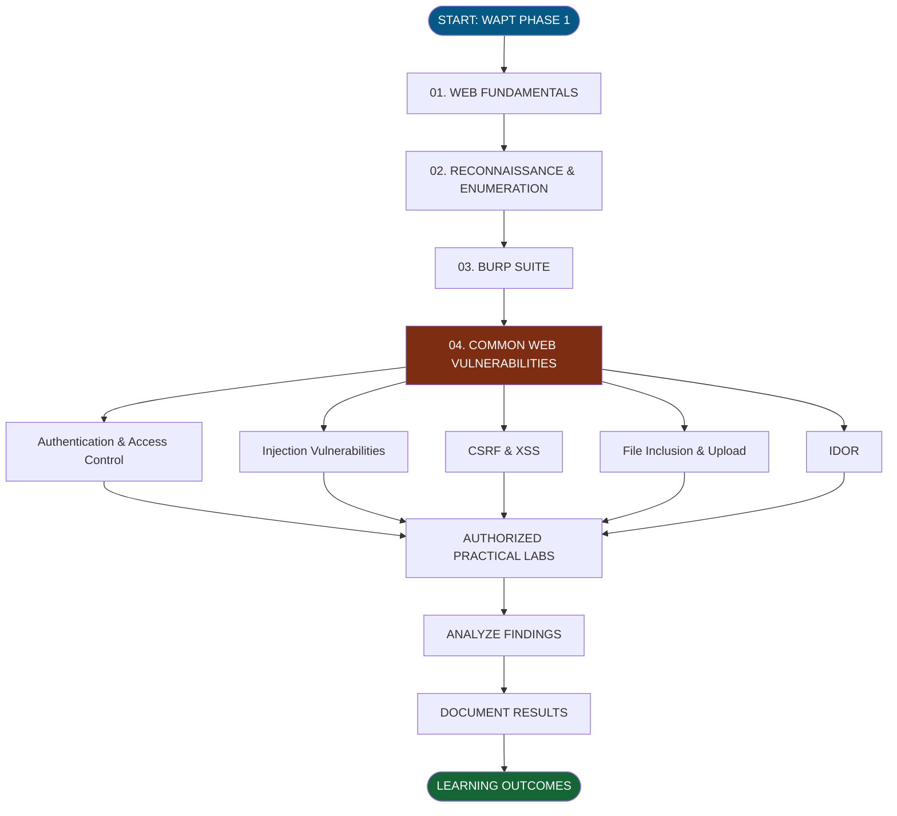
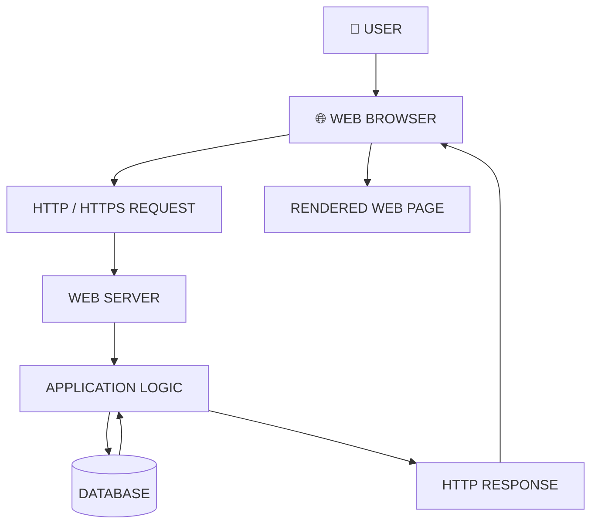
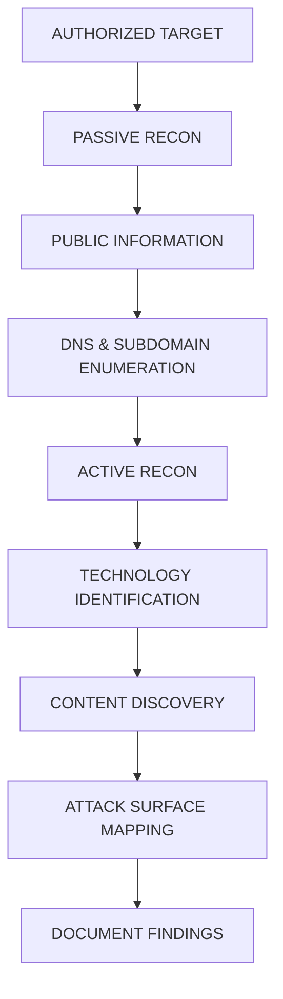
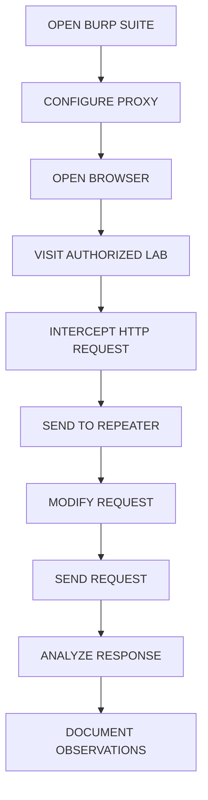
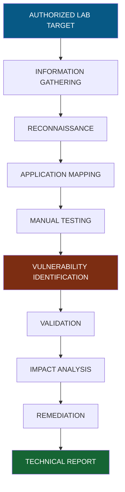

# 🌐 WEB APPLICATION SECURITY | WAPT PHASE 1

<div align="center">


### A Complete Beginner-Friendly Web Application Penetration Testing Learning Repository


**LEARN • UNDERSTAND • PRACTICE • SECURE**

</div>

---

# 📌 01. ABOUT THE PROJECT

Welcome to **Web Application Security – WAPT Phase 1**.

This repository is part of the Web Application Penetration Testing Internship at IqraSec Academy.

The objective of this learning project is to understand how modern web applications work, how they communicate with servers, how security professionals identify weaknesses, and how common web vulnerabilities can be tested in authorized environments.

This repository contains structured PDF documentation, technical concepts, tool references, installation instructions, practical testing commands, vertical workflow diagrams, and security remediation guidance.

It is designed for beginners who want to build a strong foundation in Web Application Penetration Testing (WAPT).

## 🎯 Project Objectives

- Understand web application architecture.
- Learn HTTP and HTTPS communication.
- Study client-server interactions.
- Understand passive and active reconnaissance.
- Learn subdomain and content discovery.
- Work with Burp Suite and HTTP Repeater.
- Understand common web vulnerabilities.
- Practice security testing in authorized labs.
- Analyze security findings and their impact.
- Learn vulnerability remediation and documentation.

---

# 🗺️ 02. COMPLETE LEARNING ROADMAP



---

# 🌐 03. WEB FUNDAMENTALS

**Objective:** Understand the basic structure, components, and communication mechanisms of web applications.

### Documentation

| Room | Topic | PDF |
|---|---|---|
| 01 | Web Application Basics | [Open PDF](Rohit_WAPT_Phase-1/1.Web-Fundamentals/Room1_Web-Application-Basics/Room1_Web-Application-Basics.pdf) |
| 02 | HTTP in Detail | [Open PDF](Rohit_WAPT_Phase-1/1.Web-Fundamentals/Room2_HTTP-in-Detail/Room2_HTTP-in-Detail.pdf) |

### Topics Covered

- What is a web application?
- Client-server architecture.
- Frontend and backend.
- Web servers and databases.
- HTTP and HTTPS.
- HTTP methods: GET, POST, PUT, DELETE.
- HTTP status codes.
- Headers, cookies and sessions.
- DNS fundamentals.
- Request and response analysis.

### Vertical Web Architecture



---

# 🔎 04. RECONNAISSANCE & ENUMERATION

**Objective:** Learn how to collect information about authorized targets and understand their exposed attack surface.

### Documentation

| Room | Topic | PDF |
|---|---|---|
| 01 | Passive Recon | [Open PDF](Rohit_WAPT_Phase-1/2.Recon-Enumeration/Room1_Passive-Recon/Room1_Passive-Recon.pdf) |
| 02 | Active Recon | [Open PDF](Rohit_WAPT_Phase-1/2.Recon-Enumeration/Room2_Active-Recon/Room2_Active-Recon.pdf) |
| 03 | Content Discovery | [Open PDF](Rohit_WAPT_Phase-1/2.Recon-Enumeration/Room3_Content-Discovery/Room3_Content-Discovery.pdf) |

### Topics Covered

- Information gathering.
- Passive reconnaissance.
- Active reconnaissance.
- DNS enumeration.
- Subdomain discovery.
- Technology identification.
- Directory discovery.
- Content discovery.
- Attack surface mapping.

### Reconnaissance Workflow



### Reconnaissance Tools

| Tool | Purpose |
|---|---|
| Nmap | Port and service discovery |
| Subfinder | Subdomain discovery |
| DNSx | DNS resolution |
| WhatWeb | Website technology identification |
| Gobuster | Directory and DNS discovery |
| Katana | Web crawling |
| curl | HTTP communication |
| Nuclei | Template-based security checks |

### Basic Commands

**Nmap – Service Discovery**

```bash
nmap -sV 127.0.0.1
```

**Subfinder – Subdomain Discovery**

```bash
subfinder -d example.com -silent
```

**DNSx – DNS Resolution**

```bash
echo "example.com" | dnsx -silent
```

**WhatWeb – Technology Identification**

```bash
whatweb http://127.0.0.1
```

**Gobuster – Directory Discovery**

```bash
gobuster dir -u http://127.0.0.1:3000 \
-w /usr/share/wordlists/dirb/common.txt
```

**Katana – Web Crawling**

```bash
katana -u http://127.0.0.1:3000 -d 2
```

**Nuclei – Basic Template Scan**

```bash
nuclei -u http://127.0.0.1:3000
```

**Note:** Replace the example target with a system you own or have explicit authorization to test.

---

# 🦈 05. BURP SUITE

**Objective:** Understand HTTP interception, request modification, response analysis, and manual web application testing.

### Documentation

| Room | Topic | PDF |
|---|---|---|
| 01 | Burp Suite Repeater | [Open PDF](Rohit_WAPT_Phase-1/3.Burp-Suite/Room1_Burp-Suite-Repeater/Room1_Burp-Suite-Repeater.pdf) |

### Topics Covered

- Burp Suite fundamentals.
- Proxy configuration.
- HTTP request interception.
- Request modification.
- Repeater functionality.
- Response analysis.
- Manual security testing.

### Burp Suite Workflow



### Important Burp Suite Features

| Feature | Purpose |
|---|---|
| Proxy | Intercept HTTP traffic |
| Repeater | Modify and resend requests |
| Intruder | Automated request testing |
| Decoder | Encode and decode data |
| Comparer | Compare requests and responses |
| Logger | Review HTTP traffic |

### Basic Repeater Testing

1. Start Burp Suite.
2. Configure the browser proxy.
3. Open an authorized test application.
4. Intercept an HTTP request.
5. Send it to Repeater.
6. Modify an allowed test parameter.
7. Send the request.
8. Analyze the response.

---

# 🛡️ 06. COMMON WEB APPLICATION VULNERABILITIES

This module covers common web security weaknesses and their testing methodologies.

## Vulnerability Index

| No. | Topic | Documentation |
|---|---|---|
| 01 | Authentication & Access Control | [PDF](Rohit_WAPT_Phase-1/4.Common-Web-Vulnerabilities/Authentication-Access-Control/Authentication-Access-Control.pdf) |
| 02 | Broken Access Control | [PDF](Rohit_WAPT_Phase-1/4.Common-Web-Vulnerabilities/Broken%20Access%20Control/Broken%20Access%20Control.pdf) |
| 03 | Command Injection | [PDF](Rohit_WAPT_Phase-1/4.Common-Web-Vulnerabilities/Command%20Injection/Command%20Injection.pdf) |
| 04 | CSRF | [PDF](Rohit_WAPT_Phase-1/4.Common-Web-Vulnerabilities/CSRF%20intro/CSRF%20intro.pdf) |
| 05 | File Inclusion | [PDF](Rohit_WAPT_Phase-1/4.Common-Web-Vulnerabilities/File%20Inclusion/File%20Inclusion.pdf) |
| 06 | IDOR | [PDF](Rohit_WAPT_Phase-1/4.Common-Web-Vulnerabilities/IDOR/IDOR.pdf) |
| 07 | OWASP Juice Shop | [PDF](Rohit_WAPT_Phase-1/4.Common-Web-Vulnerabilities/OWASP%20JUICE%20SHOP/OWASP%20JUICE%20SHOP.pdf) |
| 08 | PortSwigger Labs | [PDF](Rohit_WAPT_Phase-1/4.Common-Web-Vulnerabilities/PortSwigger-Lab/PortSwigger-Lab.pdf) |
| 09 | SQL Injection | [PDF](Rohit_WAPT_Phase-1/4.Common-Web-Vulnerabilities/SQL-Injection/SQL-Injection.pdf) |
| 10 | Upload Vulnerabilities | [PDF](Rohit_WAPT_Phase-1/4.Common-Web-Vulnerabilities/Upload%20Vulnerabilities/Upload%20Vulnerabilities.pdf) |
| 11 | Cross-Site Scripting | [PDF](Rohit_WAPT_Phase-1/4.Common-Web-Vulnerabilities/XSS/XSS.pdf) |

## 01. Authentication Testing

**What is it?**

Authentication verifies the identity of a user before granting access to an application.

**Testing command:**

```bash
curl -i http://127.0.0.1:3000/login
```

Example POST request:

```bash
curl -i -X POST http://127.0.0.1:3000/login \
-d "username=testuser&password=testpass"
```

**Check:**
- Login validation.
- Session management.
- Cookie security.
- Authentication errors.
- Account protection.

**Remediation:** MFA, secure password storage, rate limiting, and secure session handling.

## 02. Broken Access Control

**What is it?**

Broken Access Control occurs when users can access resources or perform actions beyond their assigned permissions.

**Testing command:**

```bash
curl -i http://127.0.0.1:3000/admin
```

**Check:**
- Unauthorized resource access.
- Role-based permissions.
- Server-side authorization.
- HTTP 401 and 403 responses.

**Remediation:** Enforce authorization checks on every protected server-side operation.

## 03. Command Injection

**What is it?**

Command Injection occurs when an application incorrectly passes untrusted user input into operating system commands.

**Basic lab input:**

```text
127.0.0.1; id
```

Another example:

```text
127.0.0.1 && whoami
```

**Check:**
- Unexpected command execution.
- Unsafe input handling.
- Application output.
- Server-side command processing.

**Remediation:** Avoid shell execution, use safe APIs, and validate input.

## 04. Cross-Site Request Forgery (CSRF)

**What is it?**

CSRF attempts to make an authenticated user's browser perform an unwanted action.

**Testing checklist:**

```text
1. Identify a state-changing request.
2. Inspect the HTTP method.
3. Check CSRF token implementation.
4. Review token validation.
5. Inspect SameSite cookie attributes.
6. Review Origin validation.
```

**Remediation:** Use CSRF tokens, appropriate SameSite cookies, and server-side request validation.

## 05. File Inclusion

**What is it?**

File Inclusion vulnerabilities occur when an application improperly handles user-controlled file paths or file references.

**Basic lab test input:**

```text
../../../../etc/passwd
```

**Testing example:**

```bash
curl -i "http://127.0.0.1:3000/view?file=../../../../etc/passwd"
```

**Check:**
- Path traversal behavior.
- File access restrictions.
- Input validation.
- Secure path handling.

**Remediation:** Use strict file allowlists and safe path resolution.

## 06. IDOR

**What is it?**

Insecure Direct Object Reference occurs when an application exposes object identifiers without properly checking whether the current user is authorized to access the requested object.

**Testing example:**

```bash
curl -i http://127.0.0.1:3000/api/users/1001
```

Compare with another test account's resource in your lab:

```bash
curl -i http://127.0.0.1:3000/api/users/1002
```

**Check:**
- Object ownership.
- User permissions.
- API response differences.
- Unauthorized data exposure.

**Remediation:** Implement object-level authorization checks.

## 07. SQL Injection

**What is it?**

SQL Injection occurs when untrusted input is incorrectly incorporated into database queries.

**Basic lab payload:**

```sql
' OR '1'='1'--
```

**Testing example:**

```bash
curl -i -G "http://127.0.0.1:3000/search" \
--data-urlencode "q=' OR '1'='1'--"
```

**Check:**
- Database errors.
- Unexpected query behavior.
- Input handling.
- Database error disclosure.

**Remediation:** Use parameterized queries and prepared statements.

## 08. File Upload Vulnerabilities

**What is it?**

File upload vulnerabilities occur when an application does not properly validate or securely store uploaded files.

**Create a harmless test file:**

```bash
echo "WAPT Upload Test" > test.txt
```

**Upload to an authorized lab endpoint:**

```bash
curl -i -X POST \
-F "file=@test.txt" \
http://127.0.0.1:3000/upload
```

**Check:**
- File extension validation.
- MIME type validation.
- File size restrictions.
- Secure storage.
- File access permissions.

**Remediation:** Validate uploaded content, generate safe filenames, and store files outside executable web directories.

## 09. Cross-Site Scripting (XSS)

**What is it?**

XSS occurs when an application allows untrusted content to execute as JavaScript in another user's browser.

**Basic harmless lab payload:**

```html
<script>alert('XSS Test')</script>
```

**URL-encoded example:**

```text
http://127.0.0.1:3000/search?q=%3Cscript%3Ealert(1)%3C%2Fscript%3E
```

**Types of XSS:**

- Reflected XSS.
- Stored XSS.
- DOM-based XSS.

**Remediation:** Context-aware output encoding, safe DOM APIs, and Content Security Policy.

---

# 🧰 07. SECURITY TOOLS INSTALLATION GUIDE

The following installation commands are intended for Kali Linux and Debian-based testing environments.

## Step 01 – Update System

```bash
sudo apt update
sudo apt upgrade -y
```

## Step 02 – Install Core Tools

```bash
sudo apt install -y \
nmap \
curl \
git \
python3 \
python3-pip \
nikto \
gobuster \
whatweb \
zaproxy \
burpsuite \
subfinder \
dnsx \
katana \
nuclei
```

If a package is unavailable in your configured repositories, install it using the tool's official documentation instead.

## Step 03 – Verify Installation

```bash
nmap --version
```

```bash
curl --version
```

```bash
nikto -Version
```

```bash
gobuster version
```

```bash
whatweb --version
```

```bash
subfinder -version
```

```bash
dnsx -version
```

```bash
katana -version
```

```bash
nuclei -version
```

## Step 04 – Launch Tools

```bash
burpsuite
```

```bash
zaproxy
```

**Note:** Burp Suite Community Edition and OWASP ZAP can also be installed using their official installation methods.

## Step 05 – Create a Working Directory

```bash
mkdir -p ~/WAPT-Lab/{Recon,Burp,Testing,Reports}
```

```bash
cd ~/WAPT-Lab
```

---

# 🔬 08. COMPLETE VULNERABILITY TESTING WORKFLOW



---

# 🧪 09. PRACTICAL LEARNING ENVIRONMENTS

## OWASP Juice Shop

OWASP Juice Shop is an intentionally vulnerable web application created for web security education and practical testing.

Official resource:

https://owasp.org/www-project-juice-shop/

## PortSwigger Web Security Academy

PortSwigger Web Security Academy provides free learning resources and interactive labs covering web application security vulnerabilities.

Official resource:

https://portswigger.net/web-security

---

# 📊 10. SECURITY REMEDIATION REFERENCE

| Vulnerability | Recommended Protection |
|---|---|
| Authentication Issues | MFA and secure session management |
| Broken Access Control | Server-side authorization |
| Command Injection | Avoid unsafe shell execution |
| CSRF | CSRF tokens and SameSite cookies |
| File Inclusion | Strict file allowlists |
| IDOR | Object-level authorization |
| SQL Injection | Parameterized SQL queries |
| File Upload | Content validation and safe storage |
| XSS | Output encoding and CSP |

---

# 📝 11. VULNERABILITY REPORTING FORMAT

Every practical finding should be documented using a consistent structure.

```text
VULNERABILITY REPORT

1. Finding Title:
2. Vulnerability Type:
3. Affected Endpoint:
4. Severity:
5. Description:
6. Testing Environment:
7. Tools Used:
8. Steps to Reproduce:
9. Evidence / Screenshots:
10. Security Impact:
11. Root Cause:
12. Recommended Remediation:
13. References:
```

Only include findings that have actually been tested and verified.

---

# 📈 12. LEARNING OUTCOMES

After completing these modules, learners are expected to understand:

- Web application architecture.
- HTTP request and response analysis.
- Passive and active reconnaissance.
- Basic enumeration techniques.
- Burp Suite Repeater.
- Common web application vulnerabilities.
- Manual security testing.
- Security impact analysis.
- Vulnerability remediation.
- Professional technical documentation.

---

# 📂 13. REPOSITORY STRUCTURE

```text
Web-Application-Basics/
│
├── README.md
│
└── Rohit_WAPT_Phase-1/
    │
    ├── 1.Web-Fundamentals/
    │   ├── Room1_Web-Application-Basics/
    │   └── Room2_HTTP-in-Detail/
    │
    ├── 2.Recon-Enumeration/
    │   ├── Room1_Passive-Recon/
    │   ├── Room2_Active-Recon/
    │   └── Room3_Content-Discovery/
    │
    ├── 3.Burp-Suite/
    │   └── Room1_Burp-Suite-Repeater/
    │
    └── 4.Common-Web-Vulnerabilities/
        ├── Authentication-Access-Control/
        ├── Broken Access Control/
        ├── Command Injection/
        ├── CSRF intro/
        ├── File Inclusion/
        ├── IDOR/
        ├── OWASP JUICE SHOP/
        ├── PortSwigger-Lab/
        ├── SQL-Injection/
        ├── Upload Vulnerabilities/
        └── XSS/
```

---

# 📚 14. REFERENCES & OFFICIAL RESOURCES

1. OWASP Top 10 – https://owasp.org/www-project-top-ten/
2. OWASP Web Security Testing Guide – https://owasp.org/www-project-web-security-testing-guide/
3. OWASP Juice Shop – https://owasp.org/www-project-juice-shop/
4. PortSwigger Web Security Academy – https://portswigger.net/web-security
5. MDN Web Docs – https://developer.mozilla.org/
6. Nmap Documentation – https://nmap.org/book/man.html
7. Burp Suite Documentation – https://portswigger.net/burp/documentation
8. Nuclei Documentation – https://docs.projectdiscovery.io/tools/nuclei
9. Kali Linux Documentation – https://www.kali.org/docs/

---

# ⚠️ 15. DISCLAIMER

This repository is intended strictly for educational purposes and authorized cybersecurity training.

All practical security testing must be performed on personally owned systems, intentionally vulnerable lab environments, or systems for which explicit permission has been obtained.

Unauthorized access, exploitation, data theft, or disruption of third-party systems is not supported.

The commands and examples provided are learning references, not confirmation that any vulnerability exists in a particular application.

---

# 👨‍💻 16. INTERNSHIP INFORMATION

| Detail | Information |
|---|---|
| Organization | IqraSec Academy |
| Internship | Web Application Penetration Testing |
| Domain | Cybersecurity |
| Phase | Phase 1 – Learning & Foundation |
| Submission Period | 1 November – 5 November 2026 |
| Repository | Web-Application-Basics |
| GitHub Profile | GhostMaskR |

---

<div align="center">


### LEARN • ANALYZE • TEST • SECURE

**Building a Strong Foundation in Web Application Security**

*Documentation maintained as part of the IqraSec Academy WAPT Internship.*

</div>
