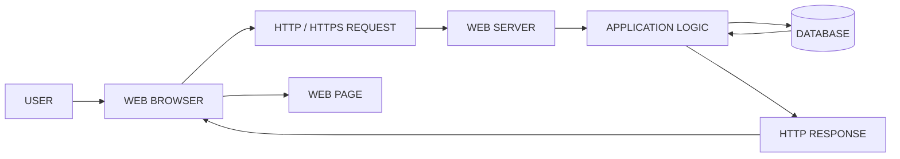
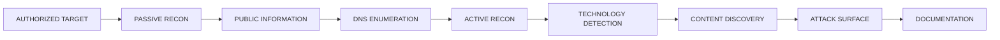
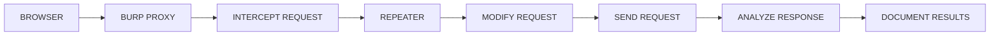

<div align="center">


# 🌐 WEB APPLICATION SECURITY
### WAPT PHASE 1 — LEARNING & FOUNDATION


**LEARN • UNDERSTAND • PRACTICE • SECURE**

</div>

---

# 📌 01. ABOUT THE PROJECT

Welcome to **Web Application Security – WAPT Phase 1**.

This repository is part of the Web Application Penetration Testing Internship at IqraSec Academy.

The objective of this project is to understand how web applications work, how they communicate with servers, how security professionals identify vulnerabilities, and how common web security weaknesses can be tested in authorized environments.

This repository contains:

- Structured PDF learning documentation.
- Web application security fundamentals.
- Reconnaissance and enumeration concepts.
- Burp Suite learning materials.
- Common web vulnerability explanations.
- Security testing tools and commands.
- Practical lab testing references.
- Workflow diagrams.
- Security remediation techniques.
- Technical learning resources.

**Designed for:** Cybersecurity beginners, students, and aspiring Web Application Penetration Testers.

---

# 🎯 02. PROJECT OBJECTIVES

- Understand web application architecture.
- Learn HTTP and HTTPS communication.
- Understand client-server interactions.
- Study passive and active reconnaissance.
- Learn DNS and subdomain enumeration.
- Understand content discovery techniques.
- Learn Burp Suite and Repeater.
- Study common web application vulnerabilities.
- Practice security testing in authorized environments.
- Analyze security findings and their impact.
- Understand vulnerability remediation.
- Develop technical documentation skills.

---

# 🗺️ 03. COMPLETE WAPT LEARNING ROADMAP


---

# 🌐 04. WEB FUNDAMENTALS

**Objective:** Understand the basic structure, technologies, and communication mechanisms of web applications.

## Documentation

| Room | Topic | Documentation |
|---|---|---|
| Room 01 | Web Application Basics | [View PDF](Rohit_WAPT_Phase-1/1.Web-Fundamentals/Room1_Web-Application-Basics/Room1_Web-Application-Basics.pdf) |
| Room 02 | HTTP in Detail | [View PDF](Rohit_WAPT_Phase-1/1.Web-Fundamentals/Room2_HTTP-in-Detail/Room2_HTTP-in-Detail.pdf) |

## Topics Covered

- What is a web application?
- Client-server architecture.
- Frontend and backend.
- Web servers and databases.
- HTTP and HTTPS.
- HTTP methods: GET, POST, PUT, DELETE.
- HTTP status codes.
- Headers, cookies, and sessions.
- DNS fundamentals.
- Request and response analysis.

## Web Application Architecture



---

# 🔎 05. RECONNAISSANCE & ENUMERATION

**Objective:** Understand how security professionals collect information about authorized targets and identify their exposed attack surface.

## Documentation

| Room | Topic | Documentation |
|---|---|---|
| Room 01 | Passive Recon | [View PDF](Rohit_WAPT_Phase-1/2.Recon-Enumeration/Room1_Passive-Recon/Room1_Passive-Recon.pdf) |
| Room 02 | Active Recon | [View PDF](Rohit_WAPT_Phase-1/2.Recon-Enumeration/Room2_Active-Recon/Room2_Active-Recon.pdf) |
| Room 03 | Content Discovery | [View PDF](Rohit_WAPT_Phase-1/2.Recon-Enumeration/Room3_Content-Discovery/Room3_Content-Discovery.pdf) |

## Topics Covered

- Information gathering.
- Passive reconnaissance.
- Active reconnaissance.
- DNS enumeration.
- Subdomain discovery.
- Technology identification.
- Directory discovery.
- Content discovery.
- Attack surface mapping.

## Reconnaissance Workflow



## Reconnaissance Tools

| Tool | Purpose |
|---|---|
| Nmap | Port and service discovery |
| Subfinder | Subdomain discovery |
| DNSx | DNS resolution |
| WhatWeb | Technology identification |
| Gobuster | Directory discovery |
| Katana | Web crawling |
| Nuclei | Template-based security checks |
| Nikto | Web server security checks |
| curl | HTTP communication |
| Browser DevTools | Web application inspection |

## Basic Recon Commands

**Nmap – Service Discovery**

```bash
nmap -sV 127.0.0.1
```

**Subfinder – Subdomain Discovery**

```bash
subfinder -d example.com -silent
```

**DNSx – DNS Resolution**

```bash
echo "example.com" | dnsx -silent
```

**WhatWeb – Technology Detection**

```bash
whatweb http://127.0.0.1
```

**Gobuster – Directory Discovery**

```bash
gobuster dir -u http://127.0.0.1:3000 \
-w /usr/share/wordlists/dirb/common.txt
```

**Katana – Web Crawling**

```bash
katana -u http://127.0.0.1:3000 -d 2
```

**Nuclei – Template-Based Testing**

```bash
nuclei -u http://127.0.0.1:3000
```

**Nikto – Web Server Checks**

```bash
nikto -h http://127.0.0.1:3000
```

---

# 🦈 06. BURP SUITE

**Objective:** Understand HTTP interception, request modification, and response analysis using Burp Suite.

## Documentation

| Room | Topic | Documentation |
|---|---|---|
| Room 01 | Burp Suite Repeater | [View PDF](Rohit_WAPT_Phase-1/3.Burp-Suite/Room1_Burp-Suite-Repeater/Room1_Burp-Suite-Repeater.pdf) |

## Topics Covered

- Burp Suite fundamentals.
- Proxy configuration.
- HTTP request interception.
- Request modification.
- Repeater functionality.
- Response analysis.
- Manual security testing.

## Burp Suite Workflow



## Important Burp Suite Features

| Feature | Purpose |
|---|---|
| Proxy | Intercept HTTP traffic |
| Repeater | Modify and resend requests |
| Intruder | Automated request testing |
| Decoder | Encode and decode data |
| Comparer | Compare HTTP messages |
| Logger | Review HTTP traffic |

## Basic Testing Procedure

1. Start Burp Suite.
2. Configure browser proxy.
3. Open an authorized test application.
4. Intercept an HTTP request.
5. Send it to Repeater.
6. Modify a test parameter.
7. Send the request.
8. Analyze the response.
9. Document observations.

---

# 🛡️ 07. COMMON WEB APPLICATION VULNERABILITIES

This module covers common web security weaknesses, their root causes, testing methodologies, potential impact, and remediation.

## Vulnerability Documentation Index

| No. | Topic | Documentation |
|---|---|---|
| 01 | Authentication & Access Control | [PDF](Rohit_WAPT_Phase-1/4.Common-Web-Vulnerabilities/Authentication-Access-Control/Authentication-Access-Control.pdf) |
| 02 | Broken Access Control | [PDF](Rohit_WAPT_Phase-1/4.Common-Web-Vulnerabilities/Broken%20Access%20Control/Broken%20Access%20Control.pdf) |
| 03 | Command Injection | [PDF](Rohit_WAPT_Phase-1/4.Common-Web-Vulnerabilities/Command%20Injection/Command%20Injection.pdf) |
| 04 | CSRF | [PDF](Rohit_WAPT_Phase-1/4.Common-Web-Vulnerabilities/CSRF%20intro/CSRF%20intro.pdf) |
| 05 | File Inclusion | [PDF](Rohit_WAPT_Phase-1/4.Common-Web-Vulnerabilities/File%20Inclusion/File%20Inclusion.pdf) |
| 06 | IDOR | [PDF](Rohit_WAPT_Phase-1/4.Common-Web-Vulnerabilities/IDOR/IDOR.pdf) |
| 07 | OWASP Juice Shop | [PDF](Rohit_WAPT_Phase-1/4.Common-Web-Vulnerabilities/OWASP%20JUICE%20SHOP/OWASP%20JUICE%20SHOP.pdf) |
| 08 | PortSwigger Labs | [PDF](Rohit_WAPT_Phase-1/4.Common-Web-Vulnerabilities/PortSwigger-Lab/PortSwigger-Lab.pdf) |
| 09 | SQL Injection | [PDF](Rohit_WAPT_Phase-1/4.Common-Web-Vulnerabilities/SQL-Injection/SQL-Injection.pdf) |
| 10 | Upload Vulnerabilities | [PDF](Rohit_WAPT_Phase-1/4.Common-Web-Vulnerabilities/Upload%20Vulnerabilities/Upload%20Vulnerabilities.pdf) |
| 11 | Cross-Site Scripting (XSS) | [PDF](Rohit_WAPT_Phase-1/4.Common-Web-Vulnerabilities/XSS/XSS.pdf) |

---

## 01. AUTHENTICATION TESTING

**What is it?**

Authentication verifies the identity of a user before granting access to an application.

**Testing Commands**

```bash
curl -i http://127.0.0.1:3000/login
```

Example POST request:

```bash
curl -i -X POST http://127.0.0.1:3000/login \
-d "username=testuser&password=testpass"
```

**Testing Checklist**

- Login validation.
- Session management.
- Cookie security.
- Authentication errors.
- Account protection.
- Password handling.

**Remediation:** MFA, secure password storage, rate limiting, and secure session management.

---

## 02. BROKEN ACCESS CONTROL

**What is it?**

Broken Access Control occurs when users can access resources or perform actions beyond their assigned permissions.

**Testing Command**

```bash
curl -i http://127.0.0.1:3000/admin
```

**Testing Checklist**

- Unauthorized resource access.
- Role-based permissions.
- Server-side authorization.
- HTTP 401 and 403 responses.

**Remediation:** Enforce server-side authorization checks on every protected operation.

---

## 03. COMMAND INJECTION

**What is it?**

Command Injection occurs when an application incorrectly passes untrusted input into operating system commands.

**Basic Lab Inputs**

```text
127.0.0.1; id
```

```text
127.0.0.1 && whoami
```

**Testing Checklist**

- Unexpected command execution.
- Unsafe input handling.
- Application output.
- Server-side command processing.

**Remediation:** Avoid shell execution, use safe APIs, and validate input.

---

## 04. CROSS-SITE REQUEST FORGERY (CSRF)

**What is it?**

CSRF attempts to make an authenticated user's browser perform an unwanted action.

**Testing Checklist**

```text
1. Identify a state-changing HTTP request.
2. Inspect the HTTP method.
3. Check CSRF token implementation.
4. Review token validation.
5. Inspect SameSite cookie attributes.
6. Review Origin validation.
```

**Remediation:** Use CSRF tokens, appropriate SameSite cookies, and server-side request validation.

---

## 05. FILE INCLUSION

**What is it?**

File Inclusion vulnerabilities occur when an application improperly handles user-controlled file paths or file references.

**Basic Lab Input**

```text
../../../../etc/passwd
```

**Testing Example**

```bash
curl -i "http://127.0.0.1:3000/view?file=../../../../etc/passwd"
```

**Testing Checklist**

- Path traversal behavior.
- File access restrictions.
- Input validation.
- Safe path handling.

**Remediation:** Use strict file allowlists and safe path resolution.

---

## 06. IDOR

**What is it?**

Insecure Direct Object Reference occurs when an application exposes object identifiers without properly checking whether the current user is authorized to access the requested object.

**Testing Examples**

```bash
curl -i http://127.0.0.1:3000/api/users/1001
```

```bash
curl -i http://127.0.0.1:3000/api/users/1002
```

Use only test accounts and resources in your authorized lab.

**Testing Checklist**

- Object ownership.
- User permissions.
- API response differences.
- Unauthorized data exposure.

**Remediation:** Implement object-level authorization checks.

---

## 07. SQL INJECTION

**What is it?**

SQL Injection occurs when untrusted input is incorrectly incorporated into database queries.

**Basic Lab Payload**

```sql
' OR '1'='1'--
```

**Testing Example**

```bash
curl -i -G "http://127.0.0.1:3000/search" \
--data-urlencode "q=' OR '1'='1'--"
```

**Testing Checklist**

- Database errors.
- Unexpected query behavior.
- Input handling.
- Database error disclosure.

**Remediation:** Use parameterized queries and prepared statements.

---

## 08. FILE UPLOAD VULNERABILITIES

**What is it?**

File upload vulnerabilities occur when an application does not properly validate or securely store uploaded files.

**Create a Harmless Test File**

```bash
echo "WAPT Upload Test" > test.txt
```

**Upload to an Authorized Lab**

```bash
curl -i -X POST \
-F "file=@test.txt" \
http://127.0.0.1:3000/upload
```

**Testing Checklist**

- File extension validation.
- MIME type validation.
- File size restrictions.
- Secure storage.
- File access permissions.

**Remediation:** Validate file content, generate safe filenames, and store files outside executable web directories.

---

## 09. CROSS-SITE SCRIPTING (XSS)

**What is it?**

XSS occurs when an application allows untrusted content to execute as JavaScript in another user's browser.

**Basic Harmless Lab Payload**

```html
<script>alert('XSS Test')</script>
```

**URL-Encoded Example**

```text
http://127.0.0.1:3000/search?q=%3Cscript%3Ealert(1)%3C%2Fscript%3E
```

**Types of XSS**

- Reflected XSS.
- Stored XSS.
- DOM-based XSS.

**Testing Checklist**

- Input reflection.
- Output encoding.
- DOM manipulation.
- Browser execution.
- Content Security Policy.

**Remediation:** Context-aware output encoding, safe DOM APIs, and Content Security Policy.

---

# 🧰 08. SECURITY TOOLS INSTALLATION GUIDE

Installation examples are intended for Kali Linux and Debian-based testing environments.

## Step 01 – Update System

```bash
sudo apt update
sudo apt upgrade -y
```

## Step 02 – Install Core Tools

```bash
sudo apt install -y \
nmap \
curl \
git \
python3 \
python3-pip \
nikto \
gobuster \
whatweb \
zaproxy \
burpsuite
```

Some packages may not be available in every repository configuration. Use the official installation documentation when necessary.

## Step 03 – Install Go

```bash
sudo apt install -y golang-go
```

Verify:

```bash
go version
```

## Step 04 – Install ProjectDiscovery Tools

**Subfinder**

```bash
go install github.com/projectdiscovery/subfinder/v2/cmd/subfinder@latest
```

**DNSx**

```bash
go install github.com/projectdiscovery/dnsx/cmd/dnsx@latest
```

**Katana**

```bash
go install github.com/projectdiscovery/katana/cmd/katana@latest
```

**Nuclei**

```bash
go install github.com/projectdiscovery/nuclei/v3/cmd/nuclei@latest
```

Add Go binaries to PATH:

```bash
export PATH="$PATH:$(go env GOPATH)/bin"
```

For persistence, add that line to `~/.bashrc`, then reload:

```bash
source ~/.bashrc
```

## Step 05 – Verify Installations

```bash
nmap --version
curl --version
nikto -Version
gobuster version
whatweb --version
subfinder -version
dnsx -version
katana -version
nuclei -version
```

## Step 06 – Launch Applications

```bash
burpsuite
```

```bash
zaproxy
```

## Step 07 – Create a WAPT Working Directory

```bash
mkdir -p ~/WAPT-Lab/{Recon,Burp,Testing,Reports}
```

```bash
cd ~/WAPT-Lab
```

---

# 🔬 09. COMPLETE VULNERABILITY TESTING WORKFLOW


---

# 🧪 10. PRACTICAL LEARNING ENVIRONMENTS

## OWASP Juice Shop

OWASP Juice Shop is an intentionally vulnerable web application designed for cybersecurity education and practical security testing.

Official Website:

https://owasp.org/www-project-juice-shop/

## PortSwigger Web Security Academy

PortSwigger Web Security Academy provides free web security learning resources and interactive practical labs.

Official Website:

https://portswigger.net/web-security

---

# 🛡️ 11. SECURITY REMEDIATION REFERENCE

| Vulnerability | Recommended Protection |
|---|---|
| Authentication Issues | MFA and secure session management |
| Broken Access Control | Server-side authorization |
| Command Injection | Avoid unsafe shell execution |
| CSRF | CSRF tokens and SameSite cookies |
| File Inclusion | Strict file allowlists |
| IDOR | Object-level authorization |
| SQL Injection | Parameterized SQL queries |
| File Upload | Content validation and safe storage |
| XSS | Output encoding and CSP |

---

# 📝 12. VULNERABILITY REPORTING FORMAT

Every practical finding should be documented using a consistent structure.

```text
VULNERABILITY REPORT

1. Finding Title:
2. Vulnerability Type:
3. Affected Endpoint:
4. Severity:
5. Description:
6. Testing Environment:
7. Tools Used:
8. Steps to Reproduce:
9. Evidence / Screenshots:
10. Security Impact:
11. Root Cause:
12. Recommended Remediation:
13. References:
```

Only include findings that have actually been tested and verified.

---

# 📊 13. LEARNING OUTCOMES

After studying these modules, learners are expected to understand:

- Web application architecture.
- HTTP request and response analysis.
- Passive and active reconnaissance.
- Basic enumeration techniques.
- Burp Suite Repeater.
- Common web application vulnerabilities.
- Manual security testing.
- Security impact assessment.
- Vulnerability remediation.
- Professional technical documentation.

---

# 📂 14. REPOSITORY STRUCTURE

```text
Web-Application-Basics/
│
├── README.md
│
├── assets/
│   └── wapt-security.gif
│
└── Rohit_WAPT_Phase-1/
    │
    ├── 1.Web-Fundamentals/
    │   ├── Room1_Web-Application-Basics/
    │   └── Room2_HTTP-in-Detail/
    │
    ├── 2.Recon-Enumeration/
    │   ├── Room1_Passive-Recon/
    │   ├── Room2_Active-Recon/
    │   └── Room3_Content-Discovery/
    │
    ├── 3.Burp-Suite/
    │   └── Room1_Burp-Suite-Repeater/
    │
    └── 4.Common-Web-Vulnerabilities/
        ├── Authentication-Access-Control/
        ├── Broken Access Control/
        ├── Command Injection/
        ├── CSRF intro/
        ├── File Inclusion/
        ├── IDOR/
        ├── OWASP JUICE SHOP/
        ├── PortSwigger-Lab/
        ├── SQL-Injection/
        ├── Upload Vulnerabilities/
        └── XSS/
```

---

# 📚 15. REFERENCES & OFFICIAL RESOURCES

| Resource | Official Website |
|---|---|
| OWASP Top 10 | https://owasp.org/www-project-top-ten/ |
| OWASP WSTG | https://owasp.org/www-project-web-security-testing-guide/ |
| OWASP Juice Shop | https://owasp.org/www-project-juice-shop/ |
| PortSwigger Academy | https://portswigger.net/web-security |
| MDN Web Docs | https://developer.mozilla.org/ |
| Nmap Documentation | https://nmap.org/book/man.html |
| Burp Suite Documentation | https://portswigger.net/burp/documentation |
| Nuclei Documentation | https://docs.projectdiscovery.io/tools/nuclei |
| Kali Linux Documentation | https://www.kali.org/docs/ |

---

# ⚠️ 16. DISCLAIMER

This repository is intended strictly for educational purposes and authorized cybersecurity training.

All practical testing must be performed on personally owned systems, intentionally vulnerable lab environments, or systems for which explicit authorization has been obtained.

Unauthorized access, exploitation, data theft, or disruption of third-party systems is not supported.

The commands and examples provided are learning references and do not confirm that any vulnerability exists in a particular application.

---

# 👨‍💻 17. INTERNSHIP INFORMATION

| Detail | Information |
|---|---|
| Organization | IqraSec Academy |
| Internship | Web Application Penetration Testing |
| Domain | Cybersecurity |
| Phase | Phase 1 – Learning & Foundation |
| Submission Period | 1 November – 5 November 2026 |
| Repository | Web-Application-Basics |
| GitHub Profile | GhostMaskR |

---

<div align="center">


### GHOSTMASKR | WEB APPLICATION SECURITY

**LEARN • ANALYZE • TEST • SECURE**

*Building a strong foundation in Web Application Security.*

</div>
