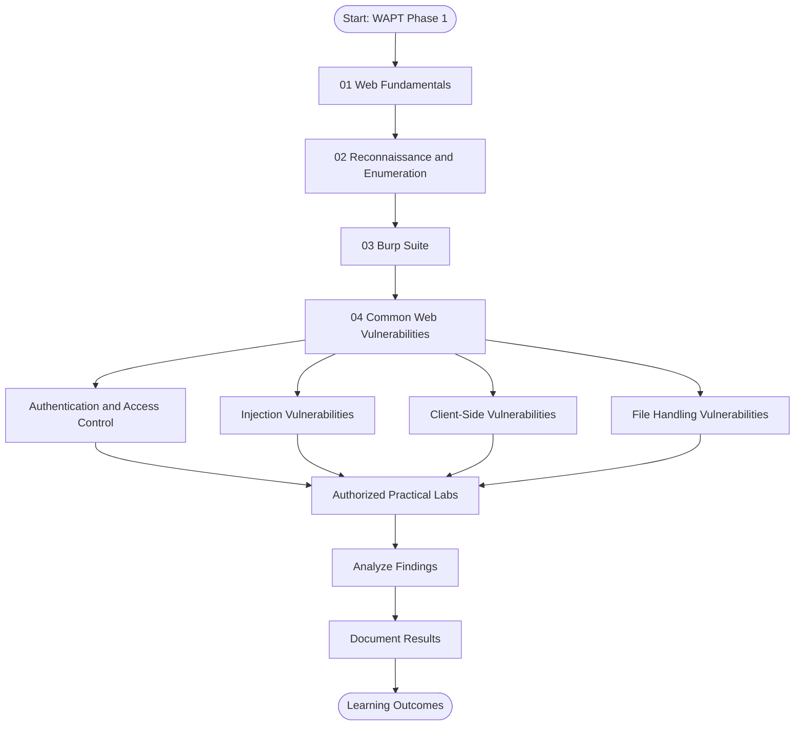
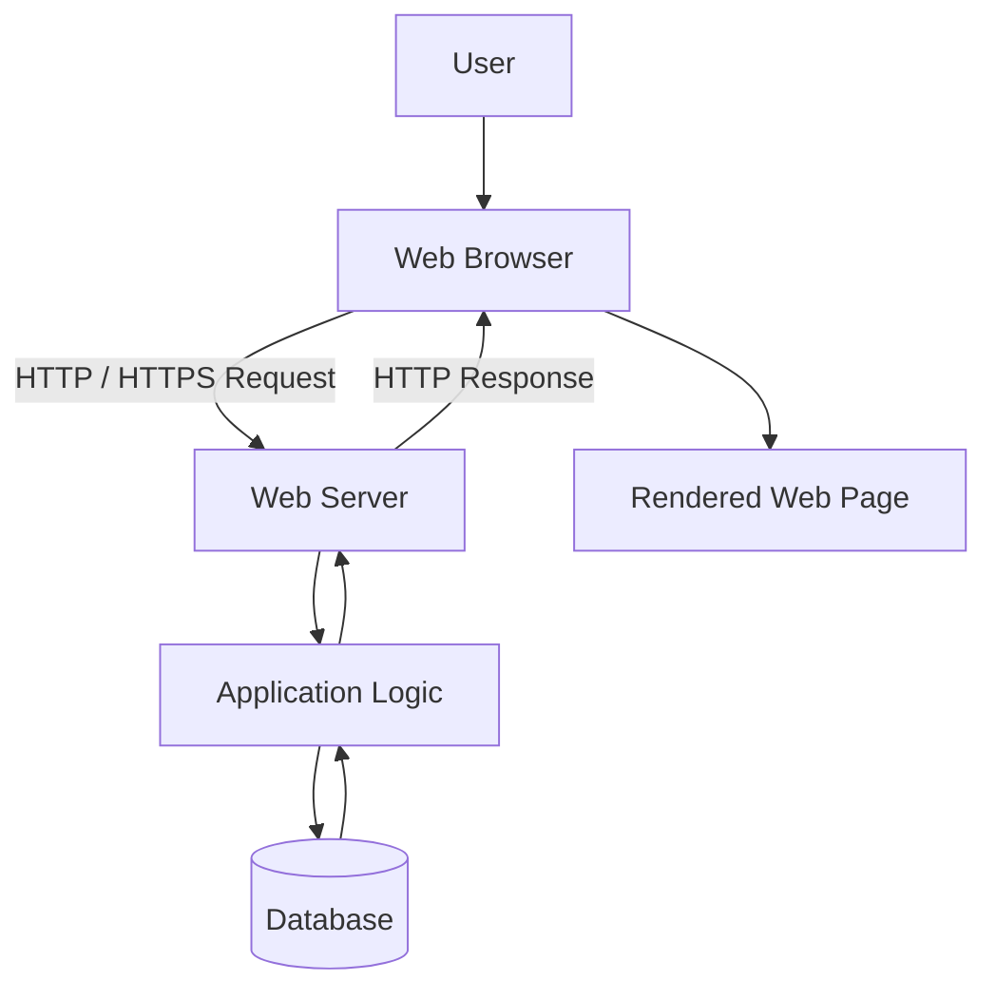
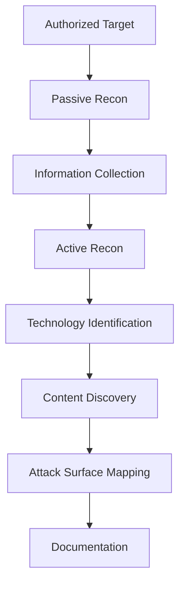
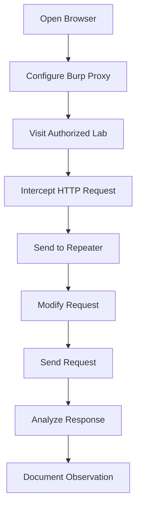

# 🌐 Web Application Security | WAPT Phase 1

<div align="center">


**A Beginner-Friendly Web Application Penetration Testing Learning Repository**


</div>

---

## 📌 About This Repository

Welcome to **Web Application Security – WAPT Phase 1**.

This repository contains structured learning documentation prepared as part of the **IqraSec Academy Web Application Penetration Testing Internship**.

The purpose of this repository is to build a strong foundation in web application security, understand how web applications communicate, explore reconnaissance methodologies, learn security testing tools, and study common web application vulnerabilities.

It is designed for beginners, cybersecurity students, and aspiring penetration testers who want to understand web security through organized theoretical documentation and authorized practical lab exercises.

**Learn the fundamentals. Understand the vulnerabilities. Practice responsibly.**

---

## 🎯 Learning Objectives

- Understand web application architecture.
- Learn HTTP and HTTPS communication.
- Understand client-server interaction.
- Explore passive and active reconnaissance.
- Learn content discovery techniques.
- Understand Burp Suite and Repeater.
- Study common web application vulnerabilities.
- Practice security testing in authorized environments.
- Analyze security findings and understand remediation.
- Develop technical documentation skills.

---

## 🧭 Learning Roadmap



---

# 📚 Learning Modules

## 01. Web Fundamentals

**Objective:** Understand the basic technologies and communication mechanisms behind web applications.

| Room | Topic | Documentation |
|---|---|---|
| Room 01 | Web Application Basics | [View PDF](1.Web-Fundamentals/Room1_Web-Application-Basics/Room1_Web-Application-Basics.pdf) |
| Room 02 | HTTP in Detail | [View PDF](1.Web-Fundamentals/Room2_HTTP-in-Detail/Room2_HTTP-in-Detail.pdf) |

### Topics Covered

- What is a web application?
- Client-server architecture.
- Frontend and backend fundamentals.
- HTTP and HTTPS.
- HTTP methods and status codes.
- Request and response structure.
- Headers, cookies and sessions.
- DNS and web communication basics.

### Web Application Architecture



## 02. Reconnaissance & Enumeration

**Objective:** Understand how security professionals collect information about an authorized web application and identify its exposed attack surface.

| Room | Topic | Documentation |
|---|---|---|
| Room 01 | Passive Recon | [View PDF](2.Recon-Enumeration/Room1_Passive-Recon/Room1_Passive-Recon.pdf) |
| Room 02 | Active Recon | [View PDF](2.Recon-Enumeration/Room2_Active-Recon/Room2_Active-Recon.pdf) |
| Room 03 | Content Discovery | [View PDF](2.Recon-Enumeration/Room3_Content-Discovery/Room3_Content-Discovery.pdf) |

### Topics Covered

- Information gathering.
- DNS enumeration.
- Subdomain discovery.
- Technology identification.
- Website footprinting.
- Directory and file discovery.
- Attack surface mapping.

### Reconnaissance Workflow



## 03. Burp Suite

**Objective:** Learn how to inspect and manipulate HTTP requests and responses using Burp Suite.

| Room | Topic | Documentation |
|---|---|---|
| Room 01 | Burp Suite Repeater | [View PDF](3.Burp-Suite/Room1_Burp-Suite-Repeater/Room1_Burp-Suite-Repeater.pdf) |

### Topics Covered

- Burp Suite fundamentals.
- Proxy and HTTP interception.
- Request and response analysis.
- Repeater functionality.
- Modifying HTTP requests.
- Analyzing server responses.
- Manual web security testing.

### Burp Suite Testing Workflow



## 04. Common Web Vulnerabilities

**Objective:** Understand common web application security weaknesses, their potential impact, testing methodology, and recommended mitigation techniques.

### Vulnerability Index

| No. | Vulnerability | Documentation |
|---|---|---|
| 01 | Authentication & Access Control | [PDF](4.Common-Web-Vulnerabilities/Authentication-Access-Control/Authentication-Access-Control.pdf) |
| 02 | Broken Access Control | [PDF](4.Common-Web-Vulnerabilities/Broken%20Access%20Control/Broken%20Access%20Control.pdf) |
| 03 | Command Injection | [PDF](4.Common-Web-Vulnerabilities/Command%20Injection/Command%20Injection.pdf) |
| 04 | CSRF | [PDF](4.Common-Web-Vulnerabilities/CSRF%20intro/CSRF%20intro.pdf) |
| 05 | File Inclusion | [PDF](4.Common-Web-Vulnerabilities/File%20Inclusion/File%20Inclusion.pdf) |
| 06 | IDOR | [PDF](4.Common-Web-Vulnerabilities/IDOR/IDOR.pdf) |
| 07 | OWASP Juice Shop | [PDF](4.Common-Web-Vulnerabilities/OWASP%20JUICE%20SHOP/OWASP%20JUICE%20SHOP.pdf) |
| 08 | PortSwigger Labs | [PDF](4.Common-Web-Vulnerabilities/PortSwigger-Lab/PortSwigger-Lab.pdf) |
| 09 | SQL Injection | [PDF](4.Common-Web-Vulnerabilities/SQL-Injection/SQL-Injection.pdf) |
| 10 | Upload Vulnerabilities | [PDF](4.Common-Web-Vulnerabilities/Upload%20Vulnerabilities/Upload%20Vulnerabilities.pdf) |
| 11 | Cross-Site Scripting (XSS) | [PDF](4.Common-Web-Vulnerabilities/XSS/XSS.pdf) |

---

# 🔬 Basic Security Testing Reference

The following examples demonstrate basic security testing concepts. Use them only against your own local lab or an intentionally vulnerable application where you have permission.

## 1. Authentication Testing

Check login endpoints and authentication responses.

```bash
curl -i http://127.0.0.1:3000/login
```

Example POST request:

```bash
curl -i -X POST http://127.0.0.1:3000/login \
-d "username=testuser&password=testpass"
```

**Check:**
- Authentication responses.
- Session management.
- Cookie security.
- Login validation.

## 2. Broken Access Control

Inspect whether protected resources enforce authorization.

```bash
curl -i http://127.0.0.1:3000/admin
```

**Check:**
- HTTP 401 and 403 responses.
- Role-based access.
- Server-side permission checks.

## 3. Command Injection

Example harmless input for a controlled lab:

```text
127.0.0.1; id
```

Another example:

```text
127.0.0.1 && whoami
```

**Check:**
- Unexpected command execution.
- Input validation.
- Secure command handling.

## 4. CSRF Testing

Testing checklist:

```text
1. Identify a state-changing HTTP request.
2. Inspect CSRF token implementation.
3. Check token validation.
4. Inspect SameSite cookie settings.
5. Review Origin validation.
6. Test using an authorized lab account.
```

## 5. File Inclusion

Example path traversal test input:

```text
../../../../etc/passwd
```

**Check:**
- Path traversal behavior.
- File access restrictions.
- Input validation.
- Safe file path handling.

## 6. IDOR Testing

Example local lab endpoint:

```bash
curl -i http://127.0.0.1:3000/api/users/1001
```

Compare with another test resource belonging to your lab:

```bash
curl -i http://127.0.0.1:3000/api/users/1002
```

**Check:**
- Object ownership.
- Authorization enforcement.
- Unauthorized data exposure.

## 7. SQL Injection

Basic SQL injection test input for a vulnerable lab:

```sql
' OR '1'='1'--
```

Example request:

```bash
curl -i -G "http://127.0.0.1:3000/search" \
--data-urlencode "q=' OR '1'='1'--"
```

**Check:**
- Unexpected query behavior.
- Database errors.
- Input handling.
- Parameterized queries.

## 8. File Upload Testing

Create a harmless test file:

```bash
echo "WAPT Upload Test" > test.txt
```

Upload to your authorized lab:

```bash
curl -i -X POST \
-F "file=@test.txt" \
http://127.0.0.1:3000/upload
```

**Check:**
- File extension validation.
- MIME type validation.
- Upload restrictions.
- Secure file storage.

## 9. Cross-Site Scripting (XSS)

Basic harmless XSS test payload:

```html
<script>alert('XSS Test')</script>
```

Example URL-encoded input:

```text
http://127.0.0.1:3000/search?q=%3Cscript%3Ealert(1)%3C%2Fscript%3E
```

**Check:**
- Reflected XSS.
- Stored XSS.
- DOM-based XSS.
- Output encoding.
- Content Security Policy.

---

# 🧪 Practical Learning Environments

## OWASP Juice Shop

OWASP Juice Shop is an intentionally vulnerable web application used for learning and practicing web application security.

Official Website:

https://owasp.org/www-project-juice-shop/

## PortSwigger Web Security Academy

A free web security training platform offering interactive learning materials and practical vulnerability labs.

Official Website:

https://portswigger.net/web-security

---

# 🛡️ Security Remediation Reference

| Vulnerability | Recommended Mitigation |
|---|---|
| Authentication Issues | MFA and secure session management |
| Broken Access Control | Server-side authorization |
| Command Injection | Avoid unsafe shell execution |
| CSRF | CSRF tokens and SameSite cookies |
| File Inclusion | Strict file allowlists |
| IDOR | Object-level authorization |
| SQL Injection | Parameterized SQL queries |
| File Upload | File validation and secure storage |
| XSS | Context-aware output encoding and CSP |

---

# 🧰 Tools & Technologies

| Tool | Purpose |
|---|---|
| Burp Suite | HTTP interception and web security testing |
| Kali Linux | Security testing environment |
| Nmap | Network and service discovery |
| curl | HTTP request testing |
| Browser DevTools | Web application inspection |
| Firefox | Web application testing |
| OWASP Juice Shop | Vulnerable training application |
| PortSwigger Academy | Interactive security labs |
| Git | Version control |
| GitHub | Documentation and project hosting |

---

# 📊 Learning Outcomes

By studying these modules, learners are expected to develop an understanding of:

- Web application architecture.
- HTTP request and response analysis.
- Basic reconnaissance methodologies.
- Content discovery concepts.
- Burp Suite Repeater.
- Common web application vulnerabilities.
- Authorized vulnerability testing.
- Security impact assessment.
- Vulnerability mitigation.
- Technical report writing.

---

# 📁 Repository Structure

```text
Web-Application-Basics/
│
├── README.md
│
├── 1.Web-Fundamentals/
│   ├── Room1_Web-Application-Basics/
│   └── Room2_HTTP-in-Detail/
│
├── 2.Recon-Enumeration/
│   ├── Room1_Passive-Recon/
│   ├── Room2_Active-Recon/
│   └── Room3_Content-Discovery/
│
├── 3.Burp-Suite/
│   └── Room1_Burp-Suite-Repeater/
│
└── 4.Common-Web-Vulnerabilities/
    ├── Authentication-Access-Control/
    ├── Broken Access Control/
    ├── Command Injection/
    ├── CSRF intro/
    ├── File Inclusion/
    ├── IDOR/
    ├── OWASP JUICE SHOP/
    ├── PortSwigger-Lab/
    ├── SQL-Injection/
    ├── Upload Vulnerabilities/
    └── XSS/
```

---

# 📖 References & Learning Resources

1. OWASP Top 10 – https://owasp.org/www-project-top-ten/
2. OWASP Web Security Testing Guide – https://owasp.org/www-project-web-security-testing-guide/
3. OWASP Juice Shop – https://owasp.org/www-project-juice-shop/
4. PortSwigger Web Security Academy – https://portswigger.net/web-security
5. MDN Web Docs – https://developer.mozilla.org/
6. RFC Editor – https://www.rfc-editor.org/

---

# ⚠️ Disclaimer

This repository is intended strictly for educational purposes and authorized cybersecurity training.

All practical testing must be conducted on personally owned systems, intentionally vulnerable lab environments, or systems for which explicit authorization has been obtained.

Unauthorized access, exploitation, data theft, or disruption of third-party systems is not supported.

---

# 👨‍💻 Internship Information

| Detail | Information |
|---|---|
| Organization | IqraSec Academy |
| Internship | Web Application Penetration Testing |
| Domain | Cybersecurity |
| Phase | Phase 1 – Learning & Foundation |
| Submission Window | 1 November – 5 November 2026 |
| Repository | Web-Application-Basics |
| GitHub | GhostMaskR |

---

<div align="center">


**LEARN • ANALYZE • TEST • SECURE**

*Building a strong foundation in Web Application Security.*

</div>
